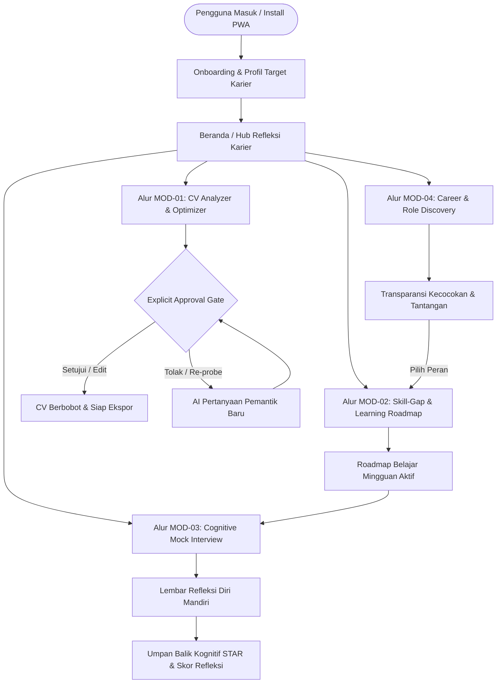

# Application Flow (AppFlow)
## CAREERSTUDENT AI — Adaptive Career Co-Pilot

---

### 1. Struktur Navigasi Utama (Global Navigation)

Aplikasi dirancang dengan pendekatan **Mobile-First PWA**, menggunakan navigasi bawah (*Bottom Navigation Bar*) untuk mobile dan bilah samping (*Sidebar Navigation*) untuk tampilan desktop.

```
+-----------------------------------------------------------------------------------+
| Top Bar: Logo CAREERSTUDENT AI | Target Role Badge | PWA Install CTA | Profil     |
+-----------------------------------------------------------------------------------+
| Navigasi Utama:                                                                   |
| [1. Dashboard]   [2. CV Analyzer]   [3. Skill Gap]   [4. Mock Interview]  [5. Jobs]|
+-----------------------------------------------------------------------------------+
```

---

### 2. Peta Alur Pengguna (User Journey Map)



---

### 3. Detail Alur Per Modul (Screen-by-Screen Flow)

#### 3.0 Alur Onboarding & Setup Persona
1. **Layar Selamat Datang:**
   - Memperkenalkan filosofi *Human-in-the-Loop* ("Bukan joki CV otomatis, melainkan rekan berpikir kritis").
   - Opsi *Add to Home Screen* jika dibuka lewat browser mobile.
2. **Setup Target Awal:**
   - Masukkan nama / persona (contoh: Rian Pratama).
   - Pilih jenjang: Mahasiswa Tingkat Akhir vs Fresh Graduate.
   - Pilih peran impian target (misal: *Junior Product Manager*, *Data Analyst*, *Frontend Engineer*).
   - Persetujuan privasi data & hak penghapusan (*Right to be Forgotten*).

---

#### 3.1 Alur MOD-01: Interactive CV / Resume Analyzer (Reflective ATS Optimizer)
*Tujuan: Mengubah poin resume yang pasif menjadi capaian berbasis dampak tanpa ghostwriting AI.*

1. **Layar Unggah CV:**
   - Pengguna mengunggah dokumen PDF atau menempelkan teks mentah.
   - Sanitasi data lokal: menghapus informasi sensitif (alamat/NIK/kontak privat) sebelum analisis.
2. **Layar Analisis & Reflective Pane:**
   - **Kolom Kiri (Desktop) / Tab 1 (Mobile):** Tampilan struktur resume asli (Pendidikan, Pengalaman, Proyek, Skills) dengan penanda skor ATS per bagian.
   - **Kolom Kanan (Desktop) / Tab 2 (Mobile) - Reflective Feedback Pane:**
     - AI mengidentifikasi poin bullet yang lemah (contoh: *"Membantu mengelola event kampus"*).
     - **Pertanyaan Sokratik AI:** *"Berapa jumlah peserta yang hadir? Apa metrik keberhasilan acara tersebut? Kendala apa yang berhasil kamu pecahkan?"*
     - Input teks refleksi pengguna untuk menjawab pertanyaan tersebut.
3. **Explicit Approval Gate Modal:**
   - AI merumuskan draf kalimat berbasis jawaban refleksi pengguna (*Action Verb + Context + Measurable Outcome*).
   - Tiga opsi wajib bagi pengguna:
     1. **[Setujui & Terapkan]:** Kalimat langsung memperbarui resume aktif.
     2. **[Edit Manual]:** Pengguna menyunting teks sendiri dalam inline-editor sebelum disimpan.
     3. **[Tolak / Regenerasi Refleksi]:** Menolak draf dan meminta sudut pandang pemantik lain dari AI.
4. **Layar Ekspor:**
   - Unduh versi resume teroptimasi (PDF/DOCX ATS-Friendly).

---

#### 3.2 Alur MOD-02: Skill-Gap Analysis & Actionable Roadmap
*Tujuan: Mengetahui kesenjangan kompetensi nyata terhadap ekspektasi industri dan menyusun rencana belajar mingguan.*

1. **Pemilihan Target Role & Basis Kompetensi:**
   - Pengguna memilih target peran atau mengambil data dari CV yang sudah diunggah.
2. **Layar Matriks Kompetensi (Gap Matrix):**
   - Menampilkan visualisasi radar / perbandingan berbasis taksonomi industri:
     - 🟢 **Strong Match:** Keterampilan yang sudah dikuasai dan terbukti di portofolio.
     - 🟡 **Partial Match:** Pernah dipelajari di kampus/proyek dasar, perlu penguatan industri.
     - 🔴 **Critical Gap:** Keterampilan krusial industri yang belum dimiliki.
3. **Penyusunan Actionable Roadmap:**
   - AI menyusun draf roadmap bertahap (Minggu 1 s/d Minggu 4).
   - Setiap minggu memuat:
     - Sasaran belajar (*Learning Objective*).
     - Proyek mini praktis (*Actionable Project Task*).
     - Kurasi referensi gratis/sertifikasi industri.
4. **Approval Gate Roadmap:**
   - Pengguna menyetujui, menyesuaikan beban jam belajar per minggu, atau memodifikasi tugas sebelum roadmap diaktifkan di dashboard tracker.

---

#### 3.3 Alur MOD-03: Cognitive Mock Interview Simulator
*Tujuan: Melatih argumentasi wawancara dengan evaluasi STAR dan menumbuhkan metakognisi pengguna.*

1. **Setup Sesi:**
   - Pilih jenis simulasi: *Behavioral (STAR Method)* atau *Situational/Role-Specific*.
   - Pilih mode input: Teks atau Suara (*Speech-to-Text*).
2. **Ruang Wawancara Adaptif:**
   - Pewawancara AI mengajukan pertanyaan pembuka berbasis peran target.
   - Pengguna memberikan jawaban.
   - **Dynamic Follow-Up Probe:** AI mendengarkan jawaban dan melontarkan pertanyaan pendalaman logis (misal: *"Menarik, ketika kamu memutuskan langkah tersebut, adakah risiko yang sempat kamu pertimbangkan dan bagaimana mitigasinya?"*).
   - Sesi berlangsung 3-5 putaran tanya-jawab dinamis.
3. **Gerbang Lembar Refleksi Diri (Mandatory Self-Reflection First):**
   - *Penting untuk tema Gen-Think:* Sebelum melihat evaluasi AI, pengguna diwajibkan mengisi formulir refleksi singkat:
     - *"Menurutmu, poin mana dari jawabanmu tadi yang paling kuat?"*
     - *"Bagian mana yang kamu rasa masih mengambang atau kurang terbukti?"*
4. **Layar Laporan Kognitif & STAR Breakdown:**
   - Evaluasi komparatif antara refleksi mandiri pengguna vs evaluasi AI.
   - Skor breakdown STAR:
     - **Situation & Task:** Kejelasan konteks dan tanggung jawab.
     - **Action:** Bobot keputusan dan peran aktif personal.
     - **Result:** Kuantifikasi dampak dan pembelajaran.
   - Rekomendasi aksi perbaikan konkret untuk sesi berikutnya.

---

#### 3.4 Alur MOD-04: Career Opportunity & Job Matching Discovery
*Tujuan: Menjelajahi alternatif peran yang relevan dengan transparansi alasan kecocokan (Explainable AI).*

1. **Layar Pencarian & Rekomendasi Peran:**
   - Daftar peran karier yang relevan berdasarkan profil kompetensi pengguna.
2. **Kartu Peluang dengan Explainability Kognitif:**
   - Bukan sekadar mencantumkan persentase kecocokan (*Match Score*), kartu dilengkapi 2 penjelasan transparan:
     - 💡 **Mengapa peran ini relevan denganmu:** Hubungan riil antara pengalaman masa lalu dengan kualifikasi peran.
     - ⚠️ **Tantangan yang perlu diantisipasi:** Kesenjangan yang mungkin menjadi hambatan seleksi.
3. **CTA Lintas Modul:**
   - Tombol **[Petakan Skill Gap Peran Ini]** yang langsung mengarahkan ke MOD-02 dengan target peran yang baru dipilih.

---

### 4. Alur Layanan PWA & Offline Resilience

1. **Deteksi Offline:**
   - Ketika koneksi internet terputus, banner visual muncul: *"Mode Offline Aktif — Draf tersimpan di perangkat lokal"*.
2. **Penyimpanan Lokal (Local Auto-Save):**
   - Jawaban teks wawancara dan suntingan CV otomatis dicadangkan ke IndexedDB / LocalStorage setiap 2 detik.
   - Saat online kembali, data disinkronkan secara mulus.
3. **Install Banner (PWA Experience):**
   - Muncul tombol install khusus di pojok antarmuka jika PWA belum terpasang di perangkat.

---

### 5. Penanganan Kondisi Khusus & Error Flow

| Skenario | Respons Sistem |
| :--- | :--- |
| **Unggah file bukan PDF/Teks rusak** | Notifikasi ramah: *"Format tidak dikenali. Silakan unggah dokumen PDF standar atau tempelkan teks CV secara manual."* |
| **Pengguna menolak semua rekomendasi AI** | Sistem beralih ke mode *Direct Manual Edit* tanpa memaksa saran AI. |
| **Koneksi terputus saat simulasi wawancara** | Transkrip jawaban yang sudah masuk disimpan, pengguna dapat melanjutkan sesi saat jaringan pulih. |
