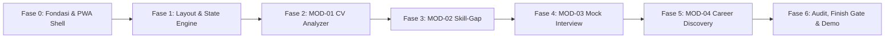

# Implementation Plan (ImplementationPlan.md)
## CAREERSTUDENT AI — Adaptive Career Co-Pilot

---

### 1. Prinsip & Standar Eksekusi (Implementation Standards)

Pelaksanaan pengembangan ini mengintegrasikan seluruh standar dari skill aktif:
1. **`progressive-web-apps-pwas`**: Memastikan fondasi PWA siap sejak awal (Web App Manifest, Service Worker caching strategies: Cache-First aset, Network-First dokumen, `offline.html` fallback, dan `beforeinstallprompt` handling).
2. **`vercel-react-best-practices`**: Menerapkan 45 aturan performa Vercel (mencegah *request waterfalls* dengan `Promise.all` / Suspense boundaries, `next/dynamic` untuk komponen berat, menghindari *barrel file imports*, optimasi serialisasi RSC, dan *client SWR/TanStack query deduplication*).
3. **`stop-making-ui-slop` & `ui-ux-pro-max-design-intelligence`**: Memenuhi *Finish Gate* sebelum fitur dinyatakan selesai (tidak ada metrik palsu, tidak ada tombol buntu, touch targets $\ge 44\text{px}$, rasio kontras WCAG $\ge 4.5:1$, transisi mikro 150–300ms, dan penanganan status: *loading*, *empty*, *error*, *offline*).
4. **`not-a-vibe-coder`**: Eksekusi terukur per fase, pengujian fungsional di setiap langkah, dan pencatatan progres pada `Tracker.md`.

---

### 2. Roadmap Pengembangan Bertahap (Phased Roadmap)

---

### 3. Rincian Langkah Kerja (Work Breakdown Structure)

#### Fase 0: Fondasi Proyek, Basis Data & Infrastruktur PWA
*Target: Menyiapkan repositori dengan stack Next.js 14 App Router, TypeScript, Prisma SQLite, dan konfigurasi PWA berstandar produksi.*
- [ ] **Task 0.1**: Inisialisasi proyek Next.js 14+ (App Router, TypeScript, Tailwind CSS, Lucide React).
- [ ] **Task 0.2**: Konfigurasi Prisma ORM dengan skema dari [`Schema.md`](file:///C:/Users/Admin/.gemini/antigravity/scratch/careerstudent-ai/Schema.md) (SQLite lokal) & jalankan migrasi awal (`prisma migrate dev`).
- [ ] **Task 0.3 (PWA Skill)**: Setup Web App Manifest (`public/manifest.json`) dengan konfigurasi `standalone`, ikon maskable (192px & 512px), dan tema warna.
- [ ] **Task 0.4 (PWA Skill)**: Buat `public/sw.js` (atau integrasi Serwist/@ducanh2912/next-pwa) dengan strategi caching:
  - Cache-First untuk aset gambar, stylesheet, dan font.
  - Network-First dengan fallback ke `/offline.html` untuk navigasi rute.
  - Stale-While-Revalidate untuk request data statis.
- [ ] **Task 0.5 (PWA Skill)**: Buat halaman `public/offline.html` mandiri yang elegan saat jaringan putus.
- [ ] **Task 0.6 (Vercel Skill)**: Setup konfigurasi bundle & import langsung (hindari *barrel imports* dari pustaka UI/ikon).

---

#### Fase 1: Desain Shell, Navigasi Mobile-First & State Machine
*Target: Membangun kerangka aplikasi responsif tanpa AI-slop dengan dukungan offline state.*
- [ ] **Task 1.1 (UI/UX Pro Max)**: Implementasi layout responsif: *Bottom Navigation Bar* di mobile ($< 768\text{px}$) dan *Sidebar Navigation* di desktop ($\ge 768\text{px}$).
- [ ] **Task 1.2 (PWA Skill)**: Buat hook `usePwaInstall` untuk menangkap event `beforeinstallprompt` dan merender tombol *Install App* kustom yang non-intrusif.
- [ ] **Task 1.3 (PWA & Offline)**: Buat hook `useNetworkStatus` dan banner status koneksi ("Mode Offline — Data tersimpan lokal").
- [ ] **Task 1.4 (Stop UI Slop)**: Bangun komponen dasar dengan *Finish Gate Checklist*:
  - State lengkap: *Skeleton Loading*, *Empty State*, *Error Boundary*, dan *Success Toast*.
  - Touch targets tombol & link minimal $44 \times 44\text{px}$.
  - State hover/focus yang stabil tanpa *layout shift*.
- [ ] **Task 1.5**: Setup Zustand store untuk profil persona (Rian Pratama), preferensi target peran, dan *local drafts*.

---

#### Fase 2: MOD-01 Interactive CV / Resume Analyzer & Socratic Optimizer
*Target: Fitur unggah CV, ekstraksi teks, analisis ATS reflektif, dan Explicit Approval Gate.*
- [ ] **Task 2.1**: Buat API endpoint `/api/resume/parse` untuk parsing file PDF (menggunakan `pdf-parse`/`unpdf`) dan sanitasi data privat secara in-memory.
- [ ] **Task 2.2**: Integrasi Google Gemini API dengan *System Prompt* persona **Socratic Career Mentor** (melarang penulisan otomatis tanpa konfirmasi pengguna).
- [ ] **Task 2.3**: Buat API endpoint `/api/resume/analyze-reflective` untuk menghasilkan kritik diksi dan pertanyaan pemantik (*Socratic Probing Questions*).
- [ ] **Task 2.4 (Vercel Skill)**: Buat antarmuka Dual-Pane responsif:
  - Tab 1: Ringkasan CV & Skor ATS Transparan (disertai rincian formula penilaian, bukan angka palsu).
  - Tab 2: *Reflective Feedback Pane* per poin bullet.
- [ ] **Task 2.5 (HITL Core)**: Bangun komponen **Explicit Approval Gate Modal**:
  - Pilihan aksi: `[Setujui & Terapkan]`, `[Edit Manual Inline]`, `[Tolak / Minta Sudut Pandang Lain]`.
- [ ] **Task 2.6 (PWA Skill)**: Implementasi penyimpanan draf revisi ke IndexedDB lokal secara otomatis setiap 2 detik.
- [ ] **Task 2.7**: Fitur ekspor CV hasil revisi yang telah disetujui (format ATS-Friendly).

---

#### Fase 3: MOD-02 Skill-Gap Analysis & Actionable Learning Roadmap
*Target: Matriks kompetensi industri dan generator roadmap mingguan yang realistis.*
- [ ] **Task 3.1**: Siapkan dataset taksonomi industri terkurasi untuk peran target (Product Manager, Data Analyst, Frontend Engineer, dll.).
- [ ] **Task 3.2**: Buat API endpoint `/api/skillgap/evaluate` untuk membandingkan keterampilan pengguna terhadap taksonomi peran target.
- [ ] **Task 3.3 (UI/UX Pro Max & Stop UI Slop)**: Bangun UI Matriks Gap Kompetensi:
  - Kategori jelas: 🟢 *Strong Match*, 🟡 *Partial Match*, 🔴 *Critical Gap*.
  - Visualisasi yang aksesibel (didukung label teks kontras tinggi, bukan sekadar warna).
  - Bukti tekstual (*evidence*) mengapa suatu skill masuk kategori tertentu.
- [ ] **Task 3.4**: Buat generator *Actionable Learning Roadmap* (4 minggu) dengan tugas konkret dan referensi modul belajar.
- [ ] **Task 3.5**: Integrasikan *Approval Gate Roadmap*: Pengguna dapat menyesuaikan jam belajar mingguan dan mencentang tugas yang disetujui sebelum diaktifkan.

---

#### Fase 4: MOD-03 Cognitive Mock Interview Simulator
*Target: Simulasi wawancara adaptif berbasis STAR dengan lembar refleksi diri wajib.*
- [ ] **Task 4.1**: Setup API endpoint `/api/interview/start` untuk inisialisasi sesi wawancara berbasis peran dan kategori (*Behavioral STAR* / *Situational*).
- [ ] **Task 4.2**: Buat API endpoint `/api/interview/submit-answer` yang mengevaluasi jawaban dan menghasilkan *Dynamic Follow-Up Probe* (pertanyaan pendalaman Sokratik).
- [ ] **Task 4.3**: Buat ruang wawancara interaktif (dukungan input teks dan Speech-to-Text browser API) dengan tampilan riwayat dialog bertahap.
- [ ] **Task 4.4 (Cognitive Bridge Core)**: Bangun **Mandatory Self-Reflection Sheet**:
  - Pengguna diwajibkan menjawab pertanyaan reflektif mandiri (*"Poin terkuat"* & *"Bagian yang belum tuntas"*) sebelum melihat evaluasi AI.
- [ ] **Task 4.5**: Buat API endpoint `/api/interview/evaluate-session` untuk menghasilkan rincian skor STAR (Situation, Task, Action, Result) dan umpan balik kognitif komparatif.
- [ ] **Task 4.6**: Halaman laporan hasil sesi wawancara dengan saran aksi latihan terarah.

---

#### Fase 5: MOD-04 Career Opportunity & Job Matching Discovery
*Target: Eksplorasi peran kerja dengan Explainable AI dan jembatan langsung ke modul Skill-Gap.*
- [ ] **Task 5.1**: Buat dataset terkurasi peluang karier relevan beserta atribut kualifikasinya.
- [ ] **Task 5.2**: Buat API endpoint `/api/career/opportunities` yang menghitung relevansi berdasarkan profil pengguna.
- [ ] **Task 5.3 (Explainable AI UI)**: Rancang kartu peluang dengan 2 komponen transparansi kognitif wajib:
  - 💡 *"Mengapa peran ini relevan denganmu"* (analisis kecocokan riil).
  - ⚠️ *"Tantangan yang perlu kamu antisipasi"* (mitigasi kesenjangan).
- [ ] **Task 5.4**: Tambahkan tombol aksi **[Petakan Skill Gap Peran Ini]** yang menghubungkan langsung peran terpilih ke MOD-02.

---

#### Fase 6: Audit Kinerja Vercel, PWA Verification & Finish Gate Review
*Target: Memastikan performa tinggi, lulus kriteria PWA, dan tampilan tanpa cacat untuk kompetisi Gen-Think.*
- [ ] **Task 6.1 (PWA Audit)**: Uji instalasi PWA di mobile & desktop; pastikan offline fallback `/offline.html` bekerja sempurna; target skor Lighthouse PWA $\ge 90$.
- [ ] **Task 6.2 (Vercel Performance Audit)**:
  - Periksa *waterfall requests* pada dashboard dan halaman analitik (pastikan fetch data dilakukan paralel).
  - Terapkan `next/dynamic` dengan ssr: false pada modul visualisasi atau parser berat.
  - Pastikan tidak ada re-render sia-sia dengan optimasi dependencies hook.
- [ ] **Task 6.3 (Stop Making UI Slop Finish Gate)**:
  - Verifikasi: tidak ada tombol placeholder/buntu.
  - Verifikasi: tidak ada angka/grafik palsu tanpa konteks data nyata.
  - Verifikasi: teks label spesifik untuk produk CareerStudent AI.
  - Verifikasi: kontras warna WCAG AA terpenuhi di semua mode.
- [ ] **Task 6.4**: Siapkan skenario pengujian demo langsung (*live demo script*) untuk presentasi juri kompetisi Gen-Think.

---

### 4. Definisi Selesai (Definition of Done — DoD)

Sebuah tugas dinyatakan selesai jika:
1. Kode TypeScript bebas dari type error dan lint warning.
2. Komponen mematuhi aturan aksesibilitas (kontras $\ge 4.5:1$, touch target $\ge 44\text{px}$).
3. Alur data mematuhi prinsip *Human-in-the-Loop* (ada konfirmasi pengguna untuk setiap perubahan draf).
4. Berkas `Tracker.md` diperbarui dengan status progres terkini.
