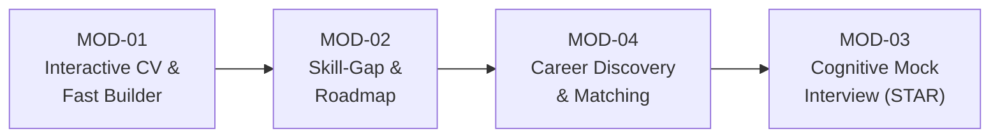
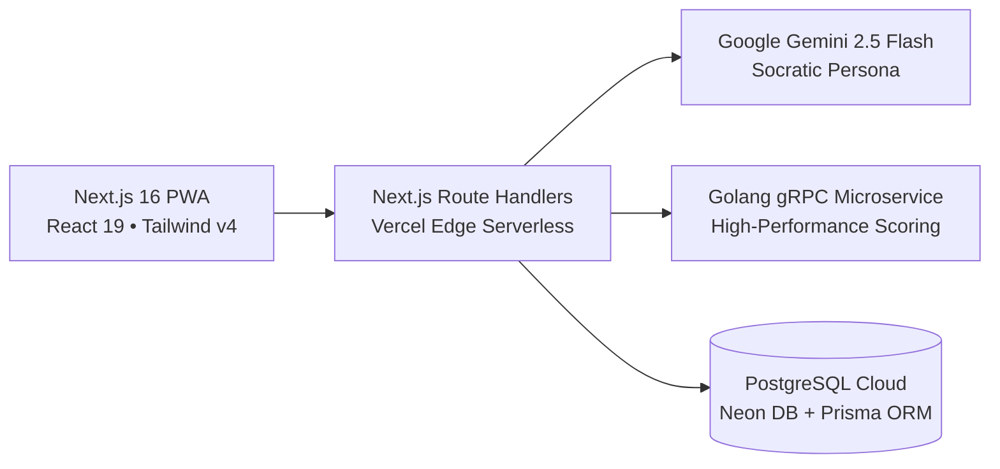

# PITCH DECK PRESENTASI INOVASI DIGITAL
## GDI FEST 2026 — *Generasi Digital Intelektual*
### Tema: *"Gen-Think: Bridging Human Intelligence in the Digital Era"*

---

# **CAREERSTUDENT AI**
### *Adaptive Career Co-Pilot Berbasis Human-in-the-Loop & Socratic Dialogue*
**Menjembatani Kesiapan Kerja Mahasiswa di Era Disrupsi Kecerdasan Buatan**

---

**TIM AQUAMAN — UNIVERSITAS TEKNOKRAT INDONESIA**
*Riki Ardiansyah (Ketua / Lead Dev) • Jovan Akbar Setiodono • Fiqi Rahman Al Afkhoni*
*Akses Prototipe Langsung: [career-student-ai.vercel.app](https://career-student-ai.vercel.app)*

---

## DAFTAR STRUKTUR SLIDE PRESENTASI (12 SLIDES)

1. **Slide 1: Title & Vision Hook** — Menjembatani Nalar Manusia, Bukan Menggantikannya
2. **Slide 2: The Silent Crisis** — Epidemi *Vibe-Applying* & Jurang Pengangguran Terdidik
3. **Slide 3: What If Nothing Changes?** — Skenario Kegagalan Sistemik Tanpa Intervensi
4. **Slide 4: The Breakthrough Solution** — Memperkenalkan CAREERSTUDENT AI
5. **Slide 5: Core Ecosystem: 4 Modul Kognitif** — Dari Kertas CV Hingga Meja Wawancara
6. **Slide 6: The Secret Sauce: Human-in-the-Loop** — Kenapa Kami Bukan Sekadar ChatGPT Wrapper
7. **Slide 7: Product Demo & User Journey** — Alur Presisi 5 Menit Berbasis Dialog Sokratik
8. **Slide 8: Enterprise-Grade Architecture** — Next.js 16, Golang gRPC, PostgreSQL Cloud & OWASP
9. **Slide 9: Traction & Testing Validation** — 42/42 Blackbox Test PASS, 100% Live di Vercel
10. **Slide 10: Target Market & Persona** — 4 Rumpun Disiplin Ilmu Mahasiswa Indonesia
11. **Slide 11: Business Model & Scalability** — Kemitraan Kampus (CDC) & Model Keberlanjutan
12. **Slide 12: Tim Aquaman & Closing Statement** — Kedaulatan Berpikir di Era Kecerdasan Buatan

---

## SLIDE 1: TITLE & VISION HOOK

### 🎨 Desain Visual Slide
* **Latar Belakang:** Deep Navy Blue (`#0F172A`) dengan aksen garis tipis toska (`#14B8A6`) melengkung menyerupai lambang *infinity bridge*.
* **Elemen Kiri:** Logo Monogram **CS (CareerStudent)** baru beraksen *teal infinity bridge*, badge *"GDI FEST 2026 — Lomba Inovasi Digital"*.
* **Elemen Kanan:** Judul berukuran besar dengan kontras tinggi: **CAREERSTUDENT AI**, diikuti sub-judul berbobot filosofis.
* **Footer:** Identitas Tim Aquaman — Universitas Teknokrat Indonesia.

### 📝 Konten Slide
* **Tagline Utama:** *"Ketika Mesin Menuliskan Segalanya, Siapa yang Sebenarnya Sedang Berpikir?"*
* **Nama Produk:** **CAREERSTUDENT AI**
* **Kategori Inovasi:** Artificial Intelligence & Teknologi Pendidikan / Kesiapan Karier
* **Institusi:** Program Studi S1 Teknologi Informasi — Universitas Teknokrat Indonesia
* **Status Produk:** Production-Ready PWA • Live di Cloud • OWASP Hardened

### 🎙️ Speaker Notes (Skrip Presentasi Lisan - 30 Detik)
> *"Selamat pagi Dewan Juri yang terhormat dan rekan-rekan inovator digital. Di era ketika kecerdasan buatan bisa menulis resume dalam tiga detik, sebuah pertanyaan fundamental muncul: Apakah mahasiswa kita semakin cerdas, atau justru kehilangan kemampuan paling dasar—yaitu merefleksikan pencapaiannya sendiri? Kami dari Tim Aquaman, Universitas Teknokrat Indonesia, mempersembahkan CAREERSTUDENT AI: Adaptive Career Co-Pilot yang tidak bekerja untuk menggantikan nalar mahasiswa, melainkan menjembatani kecerdasan manusia agar memimpin di era digital."*

---

## SLIDE 2: THE SILENT CRISIS

### 🎨 Desain Visual Slide
* **Tata Letak:** Split 2 Kolom (Data Statistik Riil vs. Realitas di Lapangan).
* **Kartu Data (High Impact Callouts):**
  - **75% Resume** ditolak Applicant Tracking System (ATS) sebelum pernah dibaca manusia *(LinkedIn, 2024)*.
  - **5.73% Pengangguran Terbuka** berasal dari lulusan universitas — lebih tinggi dari lulusan vokasi *(BPS, 2024)*.
  - **44% Core Skills** berubah drastis dalam 5 tahun akibat akselerasi AI *(WEF Future of Jobs, 2023)*.
* **Visual Anomali:** Ilustrasi komparasi teks buatan ChatGPT generik yang kosong substansi vs. ekspektasi korporasi modern.

### 📝 Konten Slide
* **Judul:** Krisis Tersembunyi: Ketergantungan Palsu pada Otomatisasi AI
* **Poin Kunci:**
  1. **Epidemi *Vibe-Applying*:** Mahasiswa melamar ratusan lowongan dengan CV hasil generate AI instan tanpa memahami makna kalimat yang diklaim.
  2. **Kebutaan Kesenjangan Kompetensi (*Skill-Gap Blindness*):** Mahasiswa tidak tahu di mana posisi kompetensi mereka terhadap standar industri terkini.
  3. **Kehancuran di Tahap Wawancara:** Kandidat lolos seleksi berkas karena teks buatan mesin, tetapi gagap saat pewawancara menanyakan metodologi dan keputusan di balik proyek.

### 🎙️ Speaker Notes (Skrip Presentasi Lisan - 45 Detik)
> *"Dewan juri sekalian, mari kita lihat kenyataan pahit di lapangan. BPS mencatat lebih dari 5.7% lulusan sarjana menganggur. Bukan karena mereka tidak berbakat, melainkan karena fenomena 'vibe-applying'. Mahasiswa menyalin teks ChatGPT, menempelkannya ke CV, dan mengirimkannya ke 50 perusahaan. Tapi apa hasilnya? 75% CV mereka langsung dieliminasi mesin ATS karena diksi yang melenceng. Dan bagi mereka yang beruntung dipanggil wawancara, mereka hancur seketika ketika ditanya: 'Bagaimana persisnya Anda mencapai target itu?' Mereka terdiam, karena kalimat itu bukan hasil pengalaman mereka, melainkan halusinasi algoritma."*

---

## SLIDE 3: WHAT IF NOTHING CHANGES?

### 🎨 Desain Visual Slide
* **Gaya:** Warning Dark Accent (`#450A0A` border dengan typography merah tegas `#EF4444`).
* **Timeline Risiko 3 Tahap:**
  - *Tahun 1:* Generasi sarjana pertama yang lulus di era Gen-AI tereliminasi massal oleh verifikasi integritas korporasi.
  - *Tahun 3:* Jurang ketidakcocokan keterampilan (*skill mismatch*) melebar; perusahaan multinasional beralih ke talenta luar.
  - *Tahun 5:* Degradasi reputasi ijazah perguruan tinggi nasional di mata industri regional.

### 📝 Konten Slide
* **Judul:** Apa yang Terjadi Jika CAREERSTUDENT AI Tidak Ada?
* **Konsekuensi Nyata Ketiadaan Solusi:**
  - ❌ **Krisis Integritas Portofolio:** Industri kehilangan kepercayaan terhadap klaim di atas kertas karena membanjirnya CV sintetis.
  - ❌ **Peningkatan Angka Pengangguran Intelektual:** Mahasiswa terus 'menembak dalam kegelapan' tanpa tahu kelemahan spesifik keahlian mereka.
  - ❌ **Kematian Daya Nalar Kritis:** Generasi muda menjadi operator pasif (*prompt-dependent*) yang kehilangan kecakapan metakognitif.

### 🎙️ Speaker Notes (Skrip Presentasi Lisan - 30 Detik)
> *"Bayangkan jika kondisi ini dibiarkan tanpa intervensi. Dalam dua tahun ke depan, kampus-kampus kita akan meluluskan ribuan sarjana yang memiliki gelar di tangan, tetapi nol kemampuan bernalar terstruktur. Perusahaan kini mulai menerapkan sistem AI integrity checks untuk memblacklist CV hasil salin-tempel. Tanpa ada sistem yang membimbing mahasiswa berpikir reflektif sejak di bangku kuliah, kita sedang mempersiapkan angkatan kerja untuk gagal."*

---

## SLIDE 4: THE BREAKTHROUGH SOLUTION

### 🎨 Desain Visual Slide
* **Gaya:** Clean High-Tech Modern.
* **Pusat Slide:** Mockup antarmuka CAREERSTUDENT AI yang bersih, profesional, berlatar putih-slate dengan aksen Indigo & Teal.
* **3 Pilar Fondasi:**
  1. *Socratic Dialogue Engine* (Bukan memberi jawaban, tapi memantik refleksi).
  2. *Human-in-the-Loop Approval Gate* (Manusia adalah pengambil keputusan mutlak).
  3. *Explainable AI & Actionable Roadmap* (Transparansi algoritma tanpa black-box).

### 📝 Konten Slide
* **Judul:** Solusi: CAREERSTUDENT AI — The Cognitive Bridge
* **Definisi:** Ekosistem web progresif (PWA) berbasis kecerdasan buatan adaptif yang melatih mahasiswa menggali, merumuskan, dan mempertahankan keaslian pengalamannya.
* **Pergeseran Paradigma:**
  - *Alat Konvensional:* Mahasiswa Pasif ➔ AI Menuliskan Teks Jadi ➔ Hilang Pemahaman.
  - *CAREERSTUDENT AI:* Mahasiswa Mengingat ➔ AI Menantang dengan Pertanyaan Sokratik ➔ Approval Gate ➔ Lahir Pemahaman & CV Berbobot ATS.

### 🎙️ Speaker Notes (Skrip Presentasi Lisan - 45 Detik)
> *"Inilah jawaban kami: CAREERSTUDENT AI. Kami menolak mentah-mentah pendekatan 'black-box auto-generation'. Alih-alih membuatkan teks palsu, sistem kami bertindak layaknya seorang Career Mentor Sokratik kelas dunia. Ketika mahasiswa menulis pengalaman yang belum terukur, AI tidak mengubahnya secara sepihak. AI akan bertanya: 'Berapa persen efisiensi yang kamu hasilkan? Langkah konkret apa yang kamu ambil?' Mahasiswa dipaksa mengingat data faktual mereka sendiri. Inilah esensi Gen-Think: teknologi yang memperkuat kapasitas intelektual manusia!"*

---

## SLIDE 5: 4 CORE ECOSYSTEM MODULES

### 🎨 Desain Visual Slide
* **Format:** 4 Kotak Modul Interaktif (2x2 Grid) dengan ikon khas dan warna fungsional terarah.
* **Bagan Alir Alur Data:** Panah horizontal menghubungkan MOD-01 ➔ MOD-02 ➔ MOD-04 ➔ MOD-03.

### 📝 Konten Slide

1. **MOD-01: Interactive CV Analyzer & Fast Builder**
   - 4-Tab Fast Builder, 1-klik template industri (*Modern Executive* & *Classic ATS*), sanitasi PII otomatis, dan ekspor jsPDF instan.
2. **MOD-02: Multidisciplinary Skill-Gap Analysis**
   - Pemetaan kompetensi 4 rumpun keilmuan (IT, Bisnis, Pemasaran, Keuangan) dengan matriks warna *Strong, Partial, Critical Gap*, serta roadmap 4 minggu.
3. **MOD-03: Cognitive Mock Interview Simulator**
   - Simulasi wawancara adaptif dengan *dynamic follow-up probes*, penguncian *Mandatory Self-Reflection*, dan evaluasi 4 dimensi metode STAR.
4. **MOD-04: Career Discovery & Explainable Job Matching**
   - Rekomendasi karier transparan berbasis rumus *weighted skill-coverage* dengan penjelasan *"Mengapa relevan"* dan *"Tantangan ke depan"*.

### 🎙️ Speaker Notes (Skrip Presentasi Lisan - 45 Detik)
> *"CAREERSTUDENT AI dibangun atas 4 modul kognitif yang saling terintegrasi. Dimulai dari MOD-01 Fast Builder dan Analisis Sokratik untuk membangun CV berstandar ATS dalam 5 menit. Masuk ke MOD-02 untuk mendiagnosis kesenjangan keterampilan lintas 4 rumpun keilmuan dan menyusun roadmap belajar 4 minggu. Dilanjutkan ke MOD-04 untuk mencocokkan peluang kerja secara transparan. Dan puncaknya di MOD-03: simulasi wawancara kerja adaptif berbasis metode STAR yang melatih mahasiswa mempertanggungjawabkan setiap kata di CV mereka."*

---

## SLIDE 6: THE SECRET SAUCE: HUMAN-IN-THE-LOOP

### 🎨 Desain Visual Slide
* **Perbandingan Langsung (Side-by-Side Comparison Table):**
  - Kiri: *ChatGPT / Generic AI Builders* (Merah / Rentan).
  - Kanan: *CAREERSTUDENT AI Engine* (Hijau / Kognitif Unggul).
* **Sorotan Fitur:** Tangkapan layar antarmuka **Explicit Approval Gate Modal** (Setujui, Edit Manual, Tolak).

### 📝 Konten Slide
* **Judul:** Mengapa Kami Berbeda? Prinsip "Human-in-the-Loop"

| Parameter | AI Builder Konvensional | CAREERSTUDENT AI |
| :--- | :--- | :--- |
| **Kedaulatan Konten** | AI mengontrol teks secara penuh | Mahasiswa wajib memilih: **Setujui / Edit / Tolak** |
| **Metode Interaksi** | Output instan tanpa edukasi | **Dialog Sokratik** (memantik memori & nalar) |
| **Tahap Wawancara** | Skor instan tanpa refleksi | **Self-Reflection Gate** (wajib evaluasi diri dulu) |
| **Transparansi Sistem** | Algoritma *Black-Box* tertutup | **Explainable AI (XAI)** dengan bobot terbuka |
| **Privasi Identitas** | Data mentah dikirim ke pihak ketiga | Sanitasi otomatis NIK & telepon di memori lokal |

### 🎙️ Speaker Notes (Skrip Presentasi Lisan - 40 Detik)
> *"Apa rahasia keunggulan sistem kami? 'Human-in-the-Loop'. Kami adalah satu-satunya platform yang memberlakukan Explicit Approval Gate: AI dilarang keras mengubah teks CV tanpa izin eksplisit. Mahasiswa bisa menyetujui, mengedit secara manual, atau menolak rekomendasi. Begitu pula pada simulasi wawancara: nilai AI terkunci rapat sampai mahasiswa mengisi evaluasi mandiri. Kami tidak menciptakan ketergantungan baru; kami membangun kemandirian kognitif."*

---

## SLIDE 7: LIVE DEMO & USER JOURNEY

### 🎨 Desain Visual Slide
* **Tangkapan Layar Nyata:**
  - Foto 1: Pengisian Fast Builder 4-Tab + Live Document Preview bergaya lembar A4.
  - Foto 2: Dialog Sokratik pemantik aksi-dampak.
  - Foto 3: Hasil ekspor PDF fisik presisi tinggi berstandar ATS.
* **Badge:** *"Zero Pop-Up Blocker • 100% Client-Side Vector Generation"*.

### 📝 Konten Slide
* **Judul:** Pengalaman Pengguna: Selesai Kurang Dari 5 Menit
* **Tahapan User Journey:**
  1. *Langkah 1:* Pilih template teruji atau input draf pada 4-Tab Fast Builder.
  2. *Langkah 2:* AI menganalisis kelemahan diksi dan mengajukan pertanyaan Sokratik.
  3. *Langkah 3:* Pengguna merespons dengan data riil ➔ Tinjau di Approval Gate.
  4. *Langkah 4:* Ekspor berkas `.pdf` resmi dengan tata letak eksekutif modern / klasik ATS.

### 🎙️ Speaker Notes (Skrip Presentasi Lisan - 35 Detik)
> *"Mari kita lihat alur penggunaannya. Hanya butuh waktu kurang dari 5 menit bagi seorang mahasiswa untuk bertransformasi. Mereka memilih template teruji, mengisi data, membiarkan mesin Sokratik kami menguji kekuatan argumen pengalaman mereka, memverifikasi perbaikan di Approval Gate, dan langsung mengunduh file PDF berstandar internasional tanpa hambatan pop-up blocker. Semuanya berjalan mulus, cepat, dan mendidik."*

---

## SLIDE 8: ENTERPRISE-GRADE TECH ARCHITECTURE

### 🎨 Desain Visual Slide
* **Bagan Arsitektur Berlapis (Mermaid Architecture):**
  - Frontend: Next.js 16 (Turbopack) & React 19 PWA.
  - Backend: Vercel Serverless Route Handlers.
  - Microservices: Golang gRPC-Go dengan Protobuf v3.
  - Storage: Neon Cloud PostgreSQL dengan SSL Connection Pooling.
  - Keamanan: Hardened OWASP Top 10 Security Headers.

### 📝 Konten Slide
* **Judul:** Arsitektur Skala Industri: Tangguh, Cepat & Aman

* **Keunggulan Teknis Nyata:**
  - ⚡ **Kinerja Tinggi:** Komputasi taksonomi sub-milidetik dengan microservice Golang gRPC.
  - 🛡️ **Keamanan Kelas Perbankan:** Terlindungi dari serangan XSS, Clickjacking, dan CSRF sesuai standar OWASP.
  - 📱 **Installable PWA:** Dapat diinstal di Android, iOS, dan Desktop dengan dukungan *offline draft saving*.

### 🎙️ Speaker Notes (Skrip Presentasi Lisan - 40 Detik)
> *"Di balik antarmuka yang elegan, berdiri arsitektur teknologi berstandar enterprise. Kami mengombinasikan Next.js 16 dan React 19 di sisi frontend, diorkestrasikan dengan microservice Golang gRPC untuk kalkulasi kesenjangan kompetensi berperforma tinggi. Basis data kami telah termigrasi penuh ke PostgreSQL Neon Cloud dengan koneksi terenkripsi SSL, serta diperkuat proteksi OWASP Top 10. Ini bukan sekadar proyek tugas akhir biasa; ini adalah infrastruktur yang siap menampung ratusan ribu mahasiswa."*

---

## SLIDE 9: TRACTION & TESTING VALIDATION

### 🎨 Desain Visual Slide
* **Tampilan Metrik Uji Mutu (Quality Assurance Scoreboard):**
  - **42 / 42 Kasus Uji Blackbox:** 100% PASS *(Auth, CV, Skill-Gap, Interview, Career, PWA)*.
  - **OWASP Top 10 Pen-Test:** 10/10 Kategori PASS *(A01 hingga A10)*.
  - **14 Rute Aplikasi:** 0 Error Kompilasi Turbopack.
  - **Status Server:** 100% Uptime di Vercel Production.

### 📝 Konten Slide
* **Judul:** Validasi Kualitas: Teruji dan Lolos Uji Keamanan Ketat
* **Bukti Kesiapan Produksi:**
  - ✅ **Laporan Blackbox Terlampir:** Validasi fungsional menyeluruh dari mode tamu hingga ekspor PDF.
  - ✅ **Laporan Pentest Terlampir:** Verifikasi anti-injeksi, CSP whitelisting, dan enkripsi sesi JWT 24 jam.
  - ✅ **Laporan Debugging:** 8 insiden teknis (NextAuth Vercel, Prisma SQLite crash, OTP concurrency) telah diatasi tuntas tanpa regresi.

### 🎙️ Speaker Notes (Skrip Presentasi Lisan - 35 Detik)
> *"Kami tidak datang hanya dengan konsep di atas kertas. Aplikasi kami sudah 100% hidup dan telah melalui pengujian ketat. 42 skenario blackbox testing berhasil lulus 100%. Audit penetrasi keamanan OWASP Top 10 mencatatkan nilai sempurna di seluruh kategori. Delapan tantangan debugging kritis—termasuk migrasi cloud database dan integrasi OAuth serverless—telah diselesaikan tuntas. Aplikasi ini stabil, aman, dan siap diuji coba secara langsung oleh dewan juri hari ini juga di career-student-ai.vercel.app."*

---

## SLIDE 10: TARGET MARKET & USER PERSONA

### 🎨 Desain Visual Slide
* **Visual Segmen Pasar:** 4 Persona Mahasiswa Lintas Rumpun Keilmuan.
* **Total Addressable Market (TAM) Callout:**
  - **9.3+ Juta Mahasiswa Aktif** di lebih dari 4.500 perguruan tinggi di Indonesia *(PDDikti, 2024)*.
  - **1.8 Juta Lulusan Baru per Tahun** yang membutuhkan akselerasi kesiapan kerja.

### 📝 Konten Slide
* **Judul:** Jangkauan Pengguna Multidisiplin
* **4 Rumpun Disiplin yang Didukung:**
  1. 💻 **Teknologi & IT:** Junior Software Engineer, Data Analyst, UI/UX Designer.
  2. 💼 **Bisnis & Manajemen:** Management Trainee (MT), Product Manager, HR Specialist.
  3. 📢 **Pemasaran Digital:** Digital Marketing Specialist, Creative Content Strategist.
  4. 📊 **Keuangan & Akuntansi:** Financial Analyst, Accounting Staff.

### 🎙️ Speaker Notes (Skrip Presentasi Lisan - 30 Detik)
> *"Pasar kami sangat masif. Terdapat lebih dari 9.3 juta mahasiswa aktif di Indonesia dengan 1.8 juta sarjana baru setiap tahunnya. Berbeda dari platform kesiapan karier lain yang hanya fokus pada bidang IT, CAREERSTUDENT AI dirancang inklusif untuk 4 rumpun keilmuan: Teknologi, Manajemen Bisnis, Pemasaran Digital, hingga Keuangan. Semua mahasiswa memiliki kesempatan setara untuk memiliki resume dan persiapan wawancara berstandar global."*

---

## SLIDE 11: BUSINESS MODEL & ROADMAP

### 🎨 Desain Visual Slide
* **Bagan 2 Sisi:** Model Bisnis Berkelanjutan (Kiri) vs. Roadmap Pengembangan 6 Bulan (Kanan).
* **Roadmap Timeline:**
  - *Bulan 1–2:* Pilot Project di 5 Kampus Mitra (300+ Mahasiswa) + Integrasi Suara WebRTC.
  - *Bulan 3–4:* Kemitraan CDC Kampus & Verifikasi Portofolio Institusi.
  - *Bulan 5–6:* Dashboard Analitik Kesenjangan Kompetensi untuk Program Studi.

### 📝 Konten Slide
* **Judul:** Keberlanjutan & Rencana Implementasi Nyata
* **Model Keberlanjutan (B2C & B2B):**
  - **B2C Freemium:** Akses penuh fitur inti secara gratis untuk seluruh mahasiswa Indonesia; opsi berlangganan terjangkau untuk kuota simulasi wawancara intensif.
  - **B2B University Partnership:** Kemitraan dengan *Career Development Center* (CDC) perguruan tinggi untuk menyediakan dasbor pemantauan kesiapan kerja angkatan lulusan.

### 🎙️ Speaker Notes (Skrip Presentasi Lisan - 35 Detik)
> *"Bagaimana solusi ini berkelanjutan? Kami menerapkan model ganda: gratis untuk fitur inti bagi mahasiswa perorangan, dan kemitraan B2B dengan Pusat Karier atau Career Development Center kampus. Melalui dasbor analitik agregat, pimpinan perguruan tinggi dapat melihat di mata kuliah mana mahasiswa mereka masih memiliki kesenjangan kompetensi terhadap industri. Roadmap kami jelas: dalam 6 bulan ke depan kami akan mengintegrasikan simulasi suara interaktif berbasis WebRTC dan merangkul 5 universitas mitra pertama."*

---

## SLIDE 12: THE AQUAMAN TEAM & CLOSING VISION

### 🎨 Desain Visual Slide
* **Foto & Peran Anggota Tim:**
  - **Riki Ardiansyah (Ketua / Lead Full-Stack & AI Engineer):** Arsitektur sistem, orkestrasi Gemini AI, dan integrasi Vercel/Neon DB.
  - **Jovan Akbar Setiodono (Frontend & UI/UX Specialist):** Desain antarmuka responsif, PWA engine, dan standardisasi anti-slop.
  - **Fiqi Rahman Al Afkhoni (QA & Security Analyst):** Blackbox testing, audit keamanan OWASP, dan validasi taksonomi industri.
* **Universitas:** Universitas Teknokrat Indonesia (Kampus Sang Juara).
* **Call to Action Keren:** QR Code mengarah ke tautan aplikasi langsung + URL demo.

### 📝 Konten Slide
* **Tagline Penutup:**
  > *"AI tidak akan menggantikan mahasiswa Indonesia. Namun mahasiswa yang menggunakan AI secara kritis dan bermartabat akan menggantikan mereka yang berhenti berpikir."*
* **Akses Prototipe:** https://career-student-ai.vercel.app
* **Kode Sumber:** https://github.com/rikiardiansyah-web/CareerStudentAI

### 🎙️ Speaker Notes (Skrip Presentasi Lisan - 45 Detik)
> *"Dewan Juri yang terhormat, di balik CAREERSTUDENT AI berdiri Tim Aquaman dari Universitas Teknokrat Indonesia. Kami tidak sekadar membangun aplikasi; kami sedang menyalakan obor kedaulatan intelektual bagi jutaan sarjana muda di tanah air. Di era kecerdasan digital, manusia tidak boleh menjadi penonton apalagi korban otomatisasi. Manusia harus menjadi nakhoda. Mari bersama CAREERSTUDENT AI, kita jembatani nalar mahasiswa Indonesia menuju panggung dunia. Terima kasih, wassalamu’alaikum warahmatullahi wabarakatuh."*

---

**DOKUMEN PITCH DECK GDI FEST 2026 RESMI**
*Disusun oleh Tim Aquaman — Universitas Teknokrat Indonesia*
*Hak Cipta © 2026 CAREERSTUDENT AI. All rights reserved.*

