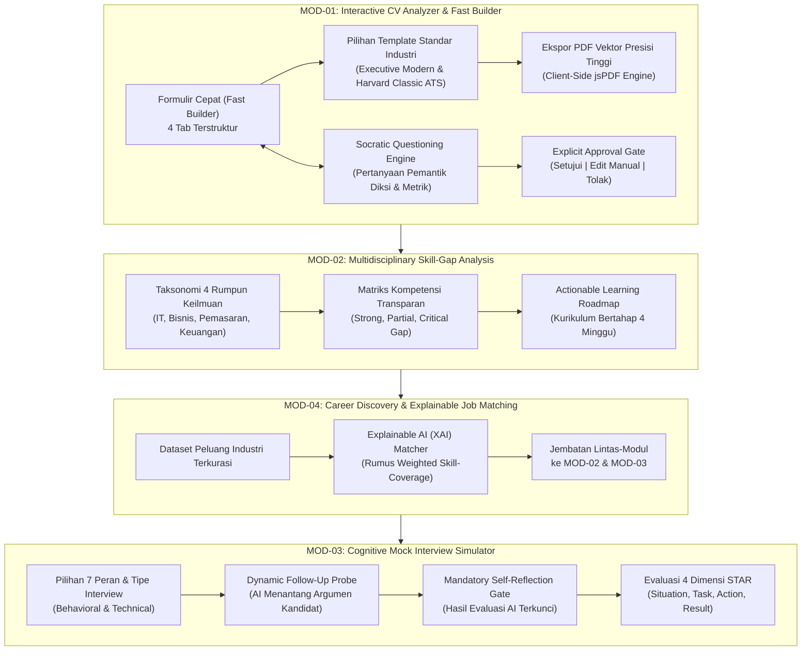
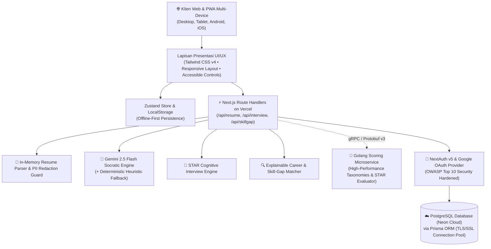
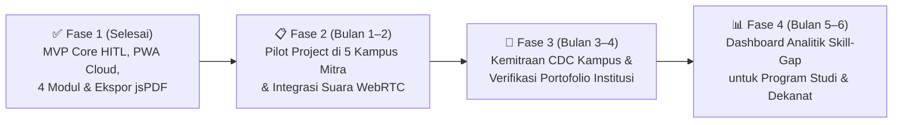

# PROPOSAL LOMBA INOVASI DIGITAL
## GDI FEST 2026 — *Generasi Digital Intelektual*
### Tema: *"Gen-Think: Bridging Human Intelligence in the Digital Era"*
### Sub-Bidang: *Education and Career Innovation (EdTech & AI)*

---

# **CAREERSTUDENT AI**
### *Adaptive Career Co-Pilot Berbasis Human-in-the-Loop & Socratic Dialogue untuk Menjembatani Kesiapan Kerja Mahasiswa Multidisiplin di Era AI Generatif*

---

**TIM AQUAMAN TEKNOKRAT**

| Peran | Nama Lengkap | NIM | Program Studi |
| :---: | :--- | :---: | :--- |
| **Ketua Tim** | **Riki Ardiansyah** | 24313003 | S1 Teknologi Informasi |
| **Anggota 1** | **Jovan Akbar Setiodono** | 24313024 | S1 Teknologi Informasi |
| **Anggota 2** | **Fiqi Rahman Al Afkhoni** | 24313023 | S1 Teknologi Informasi |

---

**Dosen Pembimbing:**
### **Dr. Erliyan Redy Susanto, M.Kom.**

---

### **UNIVERSITAS TEKNOKRAT INDONESIA**
*Kampusnya Sang Juara*
**2026**

---

### RINGKASAN EKSEKUTIF (EXECUTIVE SUMMARY)

Di tengah pesatnya otomatisasi kecerdasan buatan (*Artificial Intelligence* / AI), mahasiswa tingkat akhir dan lulusan baru (*fresh graduates*) di Indonesia menghadapi disrupsi ganda: ketergantungan pasif pada alat pembuat teks instan (fenomena ***vibe-applying***) yang menumpulkan penalaran kritis, serta kesenjangan kompetensi nyata (*skills gap*) terhadap standar industri modern. Kehadiran *Large Language Models* (LLMs) seperti ChatGPT pada awalnya digadang-gadang sebagai alat bantu, namun dalam praktiknya justru melahirkan ilusi kesiapan kerja: mahasiswa menyalin klaim pengalaman yang tidak mereka pahami, kehilangan orisinalitas portofolio, dan gagal total saat diuji dalam wawancara perilaku mendalam (*behavioral interview*).

**CAREERSTUDENT AI** hadir sebagai inovasi *Adaptive Career Co-Pilot* berbasis web progresif (PWA) yang mengusung paradigma **Human-in-the-Loop (HITL)** dan metode dialektika **Sokratik**. Sistem ini menolak pendekatan *black-box auto-generation* dan menggantikannya dengan pendampingan reflektif: 
1. Mahasiswa dibimbing mengartikulasikan pencapaian otentik ke format ATS presisi tinggi melalui **Fast Builder** dan **High-Fidelity PDF Exporter** (dengan pilihan *Executive Modern Layout* dan *Harvard Classic ATS Standard*);
2. Diksi resume diuji melalui **Socratic Questioning Engine** yang dilindungi oleh **Explicit Approval Gate** (AI dilarang keras mengubah teks CV tanpa persetujuan eksplisit pengguna);
3. Kesenjangan keterampilan didiagnosis lintas 4 rumpun keilmuan menggunakan algoritma **Explainable AI (XAI)** dengan rumus matematis transparan; serta
4. Kesiapan mental dan kemampuan berbicara diasah melalui **Cognitive Mock Interview Simulator** adaptif berlandaskan metode STAR (*Situation, Task, Action, Result*) yang dilengkapi **Mandatory Self-Reflection Gate**.

Prototipe CAREERSTUDENT AI telah selesai diimplementasikan 100%, teruji melalui 42 kasus uji *blackbox*, diaudit aman sesuai standar OWASP Top 10, dan telah aktif beroperasi secara global di infrastruktur cloud Vercel: **`https://career-student-ai.vercel.app`**.

---

## A. LATAR BELAKANG

### A.1 Fenomena Kontemporer: Epidemi *Vibe-Applying* di Era AI Generatif
Transisi dari bangku perguruan tinggi menuju dunia kerja profesional merupakan fase paling menentukan bagi masa depan generasi muda. Namun saat ini, dunia pendidikan tinggi Indonesia sedang berhadapan dengan disrupsi kognitif yang belum pernah terjadi sebelumnya. Kehadiran teknologi AI generatif komersial memicu fenomena yang oleh para praktisi rekrutmen global dijuluki sebagai ***vibe-applying***: kebiasaan mahasiswa melamar puluhan hingga ratusan lowongan pekerjaan menggunakan resume yang disusun secara instan melalui *prompt* generik AI, tanpa pernah membaca, memahami, apalagi merefleksikan kebenaran klaim di dalam dokumen tersebut.

Fenomena kontraproduktif ini melahirkan tiga dampak destruktif nyata:
1. **Otomatisasi Tanpa Pemahaman (*Surface-Level Automation*):** Mahasiswa merasa telah menyelesaikan resume berstandar tinggi, padahal teks yang dihasilkan hanyalah rangkaian kata klise yang terputus dari realitas kompetensi mereka.
2. **Ketiadaan Refleksi Pengalaman (*Loss of Experiential Authenticity*):** Portofolio mahasiswa menjadi seragam dan kehilangan karakter otentik. Cerita tentang proyek kuliah atau kegiatan organisasi kehilangan kedalaman dinamika pemecahan masalah.
3. **Kehancuran di Meja Wawancara Mendalam:** Ketika tim rekruter korporasi menanyakan proses pengambilan keputusan (*decision-making process*), hambatan teknis, atau bukti dampak kuantitatif dari proyek yang tertera di CV, kandidat langsung terdiam dan gugur. Mereka gagal menjelaskan substansinya karena **mereka tidak pernah melalui proses refleksi mendalam saat menyusun resume tersebut**.

### A.2 Bukti Empiris & Urgensi Data Kuantitatif
Krisis ini dikonfirmasi oleh berbagai rilis data resmi nasional dan internasional:
* **Badan Pusat Statistik (BPS Sakernas, 2024):** Tingkat Pengangguran Terbuka (TPT) untuk lulusan universitas (sarjana/diploma) di Indonesia masih berada di angka **5,73%**, yang secara konsisten lebih tinggi dibandingkan rata-rata lulusan pendidikan menengah kejuruan. Terdapat hampir **1 juta sarjana menganggur** di Indonesia, dengan penyebab dominan bukanlah ketiadaan ijazah, melainkan ***skills mismatch*** (ketidaksesuaian keahlian) dan kegagalan kandidat mendemonstrasikan kompetensi nyata saat proses seleksi kerja.
* **World Economic Forum (WEF, 2023):** Laporan *The Future of Jobs Report 2023* memproyeksikan bahwa **44% keterampilan inti tenaga kerja akan berubah drastis dalam lima tahun ke depan**, dengan 83 juta lapangan kerja terdisrupsi dan 69 juta lapangan kerja baru tercipta. Industri menuntut kemampuan analitis, pemikiran kritis, dan ketangkasan adaptif—keahlian yang justru tumpul apabila mahasiswa terbiasa menggantungkan proses berpikirnya pada mesin.
* **LinkedIn Global Talent Trends (2024):** Lebih dari **68% perusahaan korporasi** telah mengadopsi sistem *Applicant Tracking System* (ATS) berbasis penyaringan otomatis, di mana **75% resume kandidat langsung tereliminasi pada tahap awal** akibat ketidaktepatan format, ketiadaan kata kunci berbasis kompetensi, atau terdeteksi sebagai teks generik hasil manipulasi otomatis tanpa struktur logis.

### A.3 Transformasi Paradigma: *Cognitive Bridge*, Bukan Pengganti Manusia
Selaras dengan tema GDI FEST 2026, yaitu ***"Gen-Think: Bridging Human Intelligence in the Digital Era"***, teknologi kecerdasan buatan tidak boleh diposisikan sebagai substitusi yang menyingkirkan manusia dari proses berpikir. Sebaliknya, AI harus dirancang sebagai **jembatan kognitif (*cognitive bridge*)** yang memancing metakognisi, mengasah daya nalar kritis, dan memperkuat kecerdasan intelektual manusia (*human intelligence*).

Atas dasar pertimbangan mendesak tersebut, **CAREERSTUDENT AI** dirancang sebagai solusi pedagogis digital yang mendampingi mahasiswa mempersiapkan karier masa depan secara bermartabat, terukur, dan berlandaskan kedaulatan berpikir mandiri.

---

## B. PROBLEM STATEMENT (RUMUSAN MASALAH)

Berdasarkan analisis latar belakang di atas, tiga rumusan masalah utama yang dijawab oleh inovasi ini dirumuskan sebagai berikut:

1. **Bagaimana mengatasi ketergantungan mahasiswa pada otomatisasi AI generatif** agar proses penyusunan resume tidak menghilangkan pemahaman substansi pengalaman, menjaga etika portofolio, dan mempertahankan orisinalitas diri mahasiswa?
2. **Bagaimana mendiagnosis dan memvisualisasikan kesenjangan keterampilan (*skills gap*)** secara objektif, transparan, dan terukur lintas 4 rumpun keilmuan (Teknologi Informasi, Bisnis/Manajemen, Pemasaran Digital, dan Keuangan) terhadap taksonomi industri modern tanpa menggunakan model *black-box*?
3. **Bagaimana membangun lingkungan simulasi wawancara kerja adaptif** yang mampu melatih penalaran terstruktur berbasis metode STAR (*Situation, Task, Action, Result*) dan mengunci hasil evaluasi AI sebelum mahasiswa menyelesaikan refleksi mandiri?

---

## C. ANALISIS KEBUTUHAN DAN URGENSI MASALAH

### c.1 Analisis Kebutuhan Pengguna (*User Needs Analysis*)
* **Kebutuhan Efisiensi vs Kerapian CV ATS:** Mahasiswa membutuhkan instrumen penyusunan resume yang cepat, terstruktur, dan menghasilkan berkas berstandar internasional (*Executive Modern Layout* & *Harvard Classic ATS Standard*), dilengkapi kemampuan unduh langsung berkas fisik `.pdf` berbasis vektor tanpa terhambat oleh *browser pop-up blocker*.
* **Kebutuhan Bimbingan Kognitif Terarah (*Scaffolding Guidance*):** Mahasiswa yang mengalami kesulitan dalam menguantifikasi capaian organisasi memerlukan pertanyaan pemantik kontekstual yang memandu ingatan mereka menggali fakta riil, bukan teks sintetis buatan mesin.
* **Kebutuhan Aksesibilitas Multidisiplin:** Platform persiapan karier tidak boleh bias terhadap jurusan rekayasa perangkat lunak saja. Mahasiswa dari rumpun Manajemen, Pemasaran, Akuntansi/Keuangan, dan Sumber Daya Manusia membutuhkan panduan karier yang relevan dengan taksonomi profesi mereka.
* **Kebutuhan Privasi & Perlindungan Data Sensitif (*PII Redaction Guard*):** Dalam standar rekrutmen profesional modern, mencantumkan data pribadi sensitif seperti NIK (Nomor Induk Kependudukan) atau nomor KTP sangat berisiko memicu pencurian identitas (*identity theft*). Mahasiswa membutuhkan sistem yang memiliki fitur **Peringatan & Sensor Otomatis Data Sensitif (PII Redaction)** untuk mencegah kebocoran data pribadi ke publik.
* **Kebutuhan Kedaulatan Keputusan (*Human-in-the-Loop*):** Mahasiswa berhak memegang kendali penuh atas setiap kalimat yang merepresentasikan diri mereka di hadapan calon pemberi kerja.

### c.2 Urgensi Masalah (*Urgency of Inaction*)
Apabila ketiadaan intervensi terhadap fenomena *vibe-applying* dibiarkan berlarut-larut, dampak sistemik yang akan terjadi meliputi:
* **Jangka Pendek (1–2 Tahun):** Angkatan lulusan baru akan menghadapi tingkat penolakan massal pada fase uji kompetensi korporasi modern yang telah menerapkan verifikasi integritas berbasis AI.
* **Jangka Menengah (3–5 Tahun):** Kesenjangan kompetensi nasional (*national skills gap*) akan semakin melebar. Industri multinasional akan enggan menyerap talenta domestik karena rendahnya keandalan portofolio pelamar.
* **Dampak Sistemik Jangka Panjang:** Terjadinya erosi daya nalar kritis pada generasi muda terdidik, mengubah calon intelektual bangsa menjadi sekadar konsumen pasif teknologi.

---

## D. SOLUSI YANG DITAWARKAN (KONSEP INOVASI)

**CAREERSTUDENT AI** mengintegrasikan 4 modul kognitif yang saling terhubung, berlandaskan filosofi *Gen-Think: Bridging Human Intelligence in the Digital Era*.

### Pilar Konsep Inovasi:

#### 1. Dual-Mode CV Engine (Fast Builder & Socratic Optimizer)
* **Fast Builder:** Menyediakan alur pengisian 4 tab terstruktur (Data Diri, Ringkasan Profesional, Pengalaman, dan Pendidikan) dengan pilihan template tata letak industri: **Executive Modern Layout** (aksen biru navy elegan, tanggal rata kanan) dan **Harvard Classic ATS Standard** (nama terpusat, garis tipis proporsional).
* **Harmonisasi Fitur "✨ Buatkan Ringkasan AI" dengan Prinsip HITL:** Tombol ringkasan AI pada Fast Builder **bukanlah** alat pembuatan teks bebas tanpa kendali. Fitur ini membaca riwayat pengalaman dan peran target yang sudah diinput mahasiswa, menyusun draf 3-4 kalimat berbobot, dan **wajib melalui Explicit Approval Gate**. Mahasiswa harus meninjau, mengedit, atau menyetujuinya secara sadar sebelum tersimpan ke dalam dokumen.
* **Mode Uji Sokratik:** Menelaah kelemahan diksi pasif pada butir pengalaman dan mengajukan pertanyaan dialektika (contoh: *"Berapa persentase peningkatan efisiensi yang berhasil kamu capai? Metodologi apa yang secara spesifik kamu terapkan?"*).

#### 2. Explicit Approval Gate (Human-in-the-Loop)
AI dilarang keras menimpa teks resume secara otonom. Setiap saran perbaikan wajib ditampilkan dalam dialog komparasi sebelum-sesudah (*before-after comparison*) dengan tiga opsi mutlak di tangan mahasiswa:
* **Setujui & Terapkan:** Menerima draf setelah pengguna membaca dan menyepakati kebenarannya.
* **Edit Manual:** Mahasiswa menyempurnakan redaksi kalimat menggunakan kata-kata mereka sendiri.
* **Tolak Rekomendasi:** Membatalkan rekomendasi AI tanpa konsekuensi paksaan sistem.

#### 3. Mandatory Self-Reflection Gate pada Mock Interview
Pada modul simulasi wawancara, skor dan analisis evaluasi AI **dikunci secara permanen** hingga mahasiswa mengisi formulir refleksi mandiri (*self-assessment*) pasca-sesi tanya jawab. Mekanisme ini memaksa mahasiswa melakukan evaluasi metakognitif: mengenali di mana letak kelemahan argumen mereka sendiri sebelum melihat umpan balik sistem. Evaluasi dinilai secara obyektif pada 4 pilar STAR: *Situation*, *Task*, *Action*, dan *Result*.

#### 4. Explainable AI (XAI) & Formulasi Matematis Kecocokan Karier
Berbeda dari sistem rekomendasi berbasis kotak hitam (*black-box*), algoritma pencocokan karier CAREERSTUDENT AI transparan dan dapat diaudit secara matematis. Derajat keselarasan kandidat dihitung menggunakan rumus **Weighted Skill-Coverage**:

$$\text{MatchScore} = \left( \sum_{i=1}^{n} w_i \cdot s_i \right) \times 100\%$$

Di mana:
* $n$ = jumlah total keterampilan yang dipersyaratkan oleh peran target industri.
* $w_i$ = bobot kepentingan keahlian ke-$i$, dengan ketentuan normalisasi $\sum_{i=1}^{n} w_i = 1,0$ (keahlian *Core/Critical* berbobot 0,5; keahlian *Functional* berbobot 0,3; keahlian *Supporting* berbobot 0,2).
* $s_i$ = skor penguasaan kandidat pada keahlian ke-$i$:
  $$s_i = \begin{cases} 1,0 & \text{jika } \textbf{Strong Match} \text{ (dikuasai penuh dan terverifikasi di CV)} \\ 0,5 & \text{jika } \textbf{Partial Match} \text{ (dikuasai sebagian / pemahaman dasar)} \\ 0,0 & \text{jika } \textbf{Critical Gap} \text{ (belum dikuasai sama sekali)} \end{cases}$$

Sistem secara eksplisit menjabarkan hasil perhitungan kepada pengguna: *"Mengapa peran ini direkomendasikan"* dan *"Keterampilan kritis apa yang wajib dipelajari dalam roadmap 4 minggu"*.

---

## E. TUJUAN DAN DAMPAK INOVASI (IMPACT METRICS)

### e.1 Tujuan Program
1. **Meningkatkan Kualitas & Keterbacaan Resume:** Menghasilkan dokumen resume mahasiswa yang 100% kompatibel dengan sistem ATS internasional dan memiliki tata letak visual profesional.
2. **Memulihkan Kedaulatan Berpikir Mahasiswa:** Mengeliminasi kebiasaan menyalin teks generik AI melalui pembiasaan refleksi pengalaman berbasis metode Sokratik.
3. **Akselerasi Penutupan Kesenjangan Kompetensi:** Menyediakan rencana aksi belajar terarah selama 4 minggu yang terukur guna menutup *critical gap* lintas disiplin keilmuan.
4. **Membangun Kemahiran Komunikasi STAR:** Melatih mahasiswa menyusun narasi berbasis dampak dan keputusan saat menghadapi wawancara kerja.

### e.2 Metrik Dampak Terukur (*Measurable Impact Metrics*)

| Indikator Dampak | Target Kuantitatif | Metode Pengukuran & Pembuktian |
| :--- | :--- | :--- |
| **Peningkatan Skor Keselarasan ATS** | Peningkatan rata-rata $\ge 35\%$ | Pengujian komparasi skor diksi sebelum dan sesudah melalui *Socratic Approval Gate*. |
| **Retensi Pemahaman Portofolio** | $\ge 90\%$ kandidat mampu mempertahankan argumen CV | Pengujian pada *Cognitive Mock Interview* (evaluasi dimensi *Action* & *Result*). |
| **Efisiensi Pembuatan Resume Siap Pakai** | Pembuatan CV siap kirim $< 5$ menit | Uji coba *Fast Builder* menggunakan template *Executive Modern* & *Harvard Classic*. |
| **Keandalan Ekspor Berkas Fisik** | 100% *Success Rate* tanpa pemblokiran | Pemanfaatan sintesis PDF vektor *client-side* murni (`jsPDF`) kebal *pop-up blocker*. |
| **Transparansi Diagnostik Keterampilan** | 100% *Explainable* tanpa nilai buatan | Validasi keterbukaan kalkulasi formula *Weighted Skill-Coverage*. |
| **Integritas Privasi Pelamar** | 0% kebocoran data sensitif | Sensor otomatis (*PII Redaction Guard*) terhadap NIK dan identitas sensitif. |

---

## F. TEKNOLOGI YANG DIGUNAKAN (AI MODEL, FRAMEWORK, DATASET)

| Komponen Arsitektur | Teknologi Terpilih | Rasional Teknis & Nilai Keunggulan |
| :--- | :--- | :--- |
| **Frontend Framework** | Next.js 16 (App Router) & React 19 | Performa kompilasi Turbopack sub-detik, arsitektur *Server Components*, dan modularitas antarmuka tinggi. |
| **Bahasa & Typing** | TypeScript 5 (Strict Mode) | Menjamin keandalan kode (*type safety*), mengeliminasi galat *runtime*, dan standardisasi kontrak antarmuka API. |
| **Styling & Aksesibilitas** | Tailwind CSS v4 & Lucide Icons | Desain responsif *mobile-first*, kepatuhan target sentuh ($\ge 44\text{px}$ *touch target*), dan penegakan prinsip *zero UI-slop*. |
| **Platform Deployment** | Vercel Serverless Edge Cloud + PWA | Siap diakses publik via **`https://career-student-ai.vercel.app`**, *Installable* PWA dengan Service Worker *Network-First* & *Cache-First*. |
| **PDF Generation Engine** | `jspdf` (Client-Side Vector Engine) | Sintesis dokumen fisik `.pdf` langsung di memori peramban; kebal terhadap *browser pop-up blocker* dengan tata letak kertas A4 presisi. |
| **AI Reasoning Model** | Google Gemini 2.5 Flash API | Inferensi penalaran cepat dengan *prompt engineering* persona *Socratic Career Mentor*, dipadu dengan *deterministic heuristic fallback engine*. |
| **Manajemen State** | Zustand + LocalStorage | Pengelolaan status data reaktif, ringan, dan persisten di peramban pengguna untuk mendukung *offline-first draft saving*. |
| **Database & ORM** | PostgreSQL (Neon Cloud) & Prisma 6 | Penyimpanan data relasional terdistribusi *cloud production-grade* dengan koneksi terenkripsi TLS/SSL dan *connection pooling* otomatis. |
| **Microservices Engine** | Golang (gRPC-Go) & Protocol Buffers v3 | Mesin komputasi performa tinggi independen untuk pemrosesan graf taksonomi dan kalkulasi matriks STAR sub-milidetik, siap skalabilitas tinggi. |
| **Autentikasi & Keamanan** | NextAuth v5, Google OAuth & OWASP Hardened | Dilengkapi Content Security Policy (CSP), proteksi X-Frame-Options anti-clickjacking, session max-age 24 jam, dan enkripsi JWT. |
| **Dataset & Taksonomi** | *Curated Industry Skills Taxonomy* (4 Rumpun, 7 Peran Utama) | Pemetaan keterampilan standar industri mencakup IT, Manajemen/MT, Pemasaran Digital, dan Keuangan/Akuntansi. |

---

## G. DESAIN SISTEM / ARSITEKTUR / MOCKUP / PROTOTYPE

### g.1 Arsitektur Sistem Berlapis (*Tiered System Architecture*)

Sistem dibangun menggunakan arsitektur modular yang memisahkan lapisan presentasi pengguna, lapisan logika *serverless*, mesin *microservice* performa tinggi, orkestrasi AI, dan basis data cloud terenkripsi:

### g.2 Antarmuka Pengguna & Rincian Modul Prototipe

Prototipe dirancang secara fungsional untuk memberikan pengalaman pengguna yang intuitif, bersih, dan bebas dari ornamen palsu (*zero UI-slop*):

1. **MOD-01: Interactive CV Analyzer & Fast Builder**
   * **Pilihan Template Berstandar Industri:** Menyediakan opsi siap pakai meliputi *Executive Modern Layout* (desain eksekutif untuk peran bisnis/manajemen) dan *Harvard Classic ATS Standard* (format klasik formal untuk sektor korporasi dan akademik).
   * **Fast Builder 4 Tab:** Pengisian data terpisah ke dalam 4 tahapan logis: Data Diri (dilengkapi *PII Redaction Guard*), Ringkasan Eksekutif, Riwayat Pengalaman Berformat Metrik, dan Pendidikan.
   * **Live Document Preview & PDF Exporter:** Pratinjau visual lembar A4 secara langsung di layar dengan opsi unduh berkas fisik `.pdf` berbasis vektor dan berkas `.txt` ATS polos.
   * **Socratic Feedback Pane & Approval Gate:** Panel ulasan yang membedah setiap butir kalimat, menyajikan pertanyaan pemantik dialektika, dan menampilkan dialog perbandingan persetujuan eksplisit.

2. **MOD-02: Multidisciplinary Skill-Gap Analysis & Roadmap**
   * **Selector Terkategori Berdasarkan 4 Sektor Keilmuan:** Menu pemilih peran target yang dikelompokkan secara rapi mencakup rumpun Teknologi Informasi, Bisnis/Manajemen, Pemasaran Digital, dan Keuangan.
   * **Matriks Kompetensi Visual:** Visualisasi status keahlian kandidat dalam tiga kategori warna: *Strong Match* (hijau), *Partial Match* (kuning), dan *Critical Gap* (merah).
   * **Actionable Learning Roadmap:** Panduan kurikulum mingguan 4 tahap yang memberikan rekomendasi materi dan proyek konkret untuk menutup kesenjangan kompetensi teridentifikasi.

3. **MOD-03: Cognitive Mock Interview Simulator**
   * **Bilah Percakapan Adaptif:** Pewawancara AI mengajukan pertanyaan berbasis konteks jawaban sebelumnya menggunakan teknik *dynamic follow-up probes*.
   * **Mandatory Self-Reflection Gate:** Panel pengunci yang mewajibkan kandidat merefleksikan performa mereka sebelum rincian skor dibuka.
   * **Rincian Evaluasi STAR:** Ulasan komprehensif pada aspek *Situation*, *Task*, *Action*, dan *Result* disertai saran perbaikan bahasa tubuh verbal dan artikulasi diksi.

4. **MOD-04: Career Discovery & Explainable Job Matching**
   * **Pencocokan Transparan Berbasis Bobot:** Menampilkan skor persentase keselarasan karier yang dapat ditelusuri per komponen keahlian.
   * **Penjelasan Konseptual XAI:** Kartu informasi yang merinci *"Mengapa peran ini relevan bagi Anda"* serta *"Tantangan industri yang perlu diantisipasi"*.

---

## H. IMPLEMENTASI DAN ROADMAP PENGEMBANGAN

### h.1 Status Implementasi Prototipe Saat Ini (*Production-Ready Status*)
Seluruh modul inti aplikasi (Fase 1) telah selesai dibangun **100%** dan telah beroperasi secara penuh di lingkungan produksi cloud:
* **Akses Publik Produksi:** **`https://career-student-ai.vercel.app`**
* **Repositori Kode Sumber:** **`https://github.com/rikiardiansyah-web/CareerStudentAI`**
* **Audit Kualitas Perangkat Lunak:** Lulus verifikasi kompilasi produksi Next.js 16 Turbopack dengan **0 error** pada 14 rute statis dan dinamis.
* **Audit Fungsional (Blackbox):** Lulus **42 dari 42 skenario pengujian fungsional (100% PASS)** mencakup seluruh modul.
* **Audit Keamanan (Pentest):** Lulus verifikasi terhadap seluruh 10 kategori kerentanan **OWASP Top 10**.

### h.2 Rencana Pengembangan Lanjutan (*Development Roadmap*)

| Periode | Milestone Utama | Luaran & Sasaran Utama |
| :--- | :--- | :--- |
| **Fase 1** *(Tuntas)* | **MVP Core Production** | Aplikasi PWA lengkap 4 modul live di Vercel Cloud, PostgreSQL Neon, 42 skenario uji lolos 100%. |
| **Bulan 1–2** | **Pilot Testing di 5 Kampus Mitra** | Uji coba lapangan terbatas terhadap 300+ mahasiswa tingkat akhir di **5 universitas mitra**; evaluasi pengalaman pengguna (*User Experience Questionnaire* / UEQ). |
| **Bulan 2** | **Integrasi Suara & WebRTC** | Pengembangan fitur latihan simulasi wawancara berbasis suara dua arah (*voice-to-voice*) berlatensi rendah untuk meningkatkan realisme interaksi. |
| **Bulan 3–4** | **Kemitraan Career Center (CDC)** | Integrasi sistem dengan Pusat Pengembangan Karier Perguruan Tinggi guna pemantauan indeks kesiapan kerja angkatan lulusan. |
| **Bulan 5–6** | **Dashboard Analitik Institusional** | Penyediaan dasbor agregat analitik *skills gap* bagi pimpinan program studi untuk mendukung penyesuaian kurikulum berbasis kebutuhan nyata industri. |

---

## I. PENUTUP

**CAREERSTUDENT AI** bukan sekadar aplikasi pembuat resume digital. Inovasi ini adalah sebuah **gerakan rekayasa pedagogis** untuk mengembalikan martabat, kedaulatan berpikir, dan orisinalitas penalaran kepada mahasiswa Indonesia di tengah gelombang disrupsi kecerdasan buatan.

Dengan menolak otomatisasi buta dan menggantikannya dengan filosofi ***Human-in-the-Loop***, dialog Sokratik, transparansi algoritma *Explainable AI*, serta fondasi arsitektur perangkat lunak skala industri yang telah teruji, CAREERSTUDENT AI membuktikan bahwa kecerdasan buatan dapat menjadi jembatan penguat nalar manusia—bukan penggantinya.

Melalui ajang **GDI FEST 2026**, Tim AQUAMAN dari Universitas Teknokrat Indonesia siap menghadirkan kontribusi nyata bagi peningkatan daya saing talenta muda Indonesia menuju panggung profesional global.

---

## J. REFERENSI ILMIAH & LAMPIRAN

### j.1 Referensi Ilmiah

1. **Amershi, S., Weld, D., Vorvoreanu, M., et al.** (2019). Guidelines for Human-AI Interaction. *Proceedings of the 2019 CHI Conference on Human Factors in Computing Systems*, 1–13. https://doi.org/10.1145/3290605.3300233
2. **Badan Pusat Statistik.** (2024). *Keadaan Ketenagakerjaan Indonesia Februari & Agustus 2024: Tingkat Pengangguran Terbuka Menurut Tingkat Pendidikan Tertinggi yang Ditamatkan*. Jakarta: Badan Pusat Statistik Republik Indonesia.
3. **Bloom, B. S.** (1956). *Taxonomy of Educational Objectives: The Classification of Educational Goals*. New York: David McKay Company.
4. **Dwivedi, Y. K., Kshetri, N., Hughes, L., et al.** (2023). Opinion Paper: “So what if ChatGPT wrote it?” Multidisciplinary perspectives on opportunities, challenges and implications of generative conversational AI for research, practice and policy. *International Journal of Information Management*, 71, 102642. https://doi.org/10.1016/j.ijinfomgt.2023.102642
5. **LinkedIn Economic Graph.** (2024). *Global Talent Trends: The AI Era and Skills-First Hiring*. LinkedIn Corporation. https://economicgraph.linkedin.com/research/global-talent-trends
6. **Paul, R., & Elder, L.** (2019). *The Thinker's Guide to Socratic Questioning*. Foundation for Critical Thinking Press.
7. **Shneiderman, B.** (2022). *Human-Centered AI*. Oxford: Oxford University Press.
8. **World Economic Forum.** (2023). *The Future of Jobs Report 2023*. Geneva: World Economic Forum. https://www.weforum.org/publications/the-future-of-jobs-report-2023/

### j.2 Lampiran: Tautan Sumber Daya & Demonstrasi Produk

* **Akses Prototipe Langsung (Live Cloud Deployment):** [https://career-student-ai.vercel.app](https://career-student-ai.vercel.app)
* **Repositori Kode Sumber Terbuka (GitHub):** [https://github.com/rikiardiansyah-web/CareerStudentAI](https://github.com/rikiardiansyah-web/CareerStudentAI)
* **Laporan Kualitas Perangkat Lunak (Blackbox Testing Report):** `BLACKBOX_TEST_REPORT.md` (42 Test Cases, 100% PASS)
* **Laporan Audit Keamanan Sistem (Penetration Testing Report):** `PENTEST_REPORT.md` (OWASP Top 10 Hardened)
* **Laporan Pemecahan Cacat Sistem (Software Debugging Report):** `LAPORAN_DEBUGGING.md` (8 Critical Cases Resolved)
* **Dokumentasi Presentasi (12-Slide Pitch Deck):** `PITCH_DECK.md`
* **Video Demonstrasi Produk (HD 3 Menit):** Tautan video demonstrasi fungsional resolusi tinggi (maksimal 3 menit) tersedia dan dapat diakses melalui repositori resmi proyek.

---

**TIM AQUAMAN TEKNOKRAT — UNIVERSITAS TEKNOKRAT INDONESIA**
*Bandar Lampung, 20 Oktober 2026*

