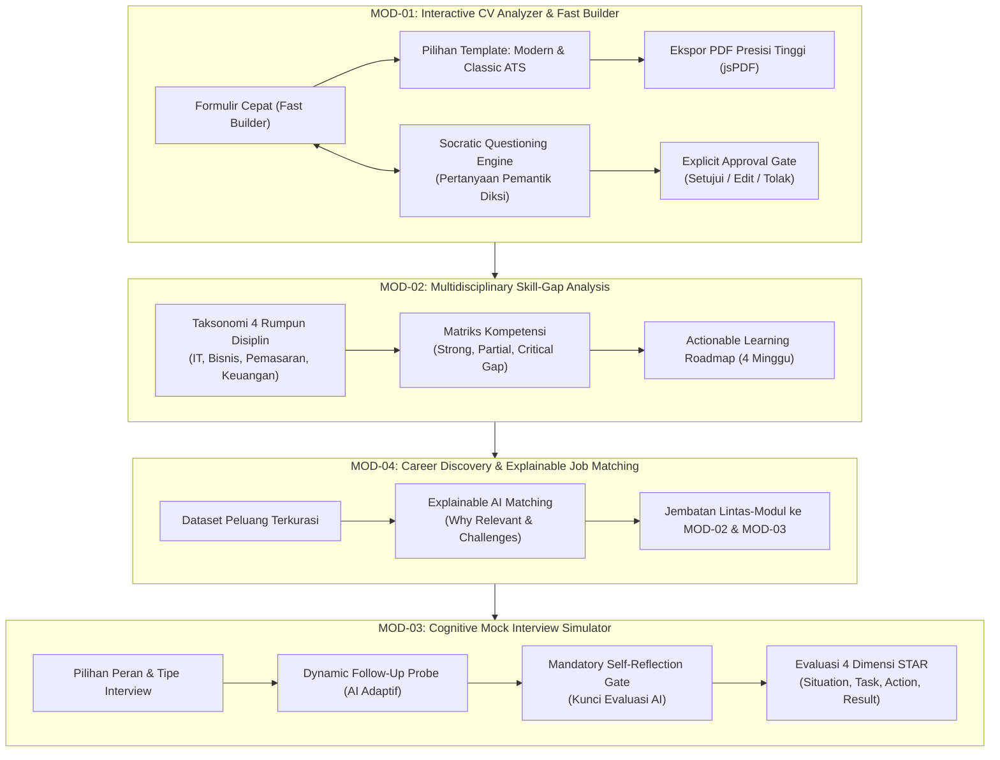
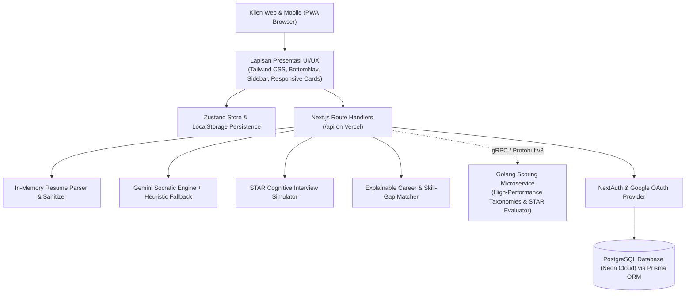
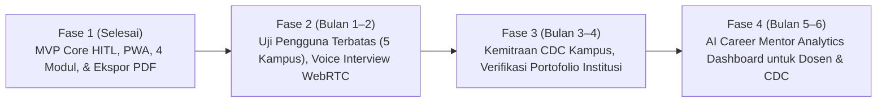

# PROPOSAL INOVASI TEKNOLOGI PENDIDIKAN & KARIER
## CAREERSTUDENT AI: Adaptive Career Co-Pilot Berbasis Human-in-the-Loop & Socratic Dialogue untuk Menjembatani Kesiapan Kerja Mahasiswa Multidisiplin di Era AI Generatif

---

### RINGKASAN EKSEKUTIF (EXECUTIVE SUMMARY)
Di tengah pesatnya otomatisasi kecerdasan buatan (Artificial Intelligence / AI), mahasiswa tingkat akhir dan lulusan baru (*fresh graduates*) di Indonesia menghadapi disrupsi ganda: ketergantungan pasif pada alat pembuat teks instan (*vibe-applying*) yang menumpulkan penalaran kritis, serta kesenjangan kompetensi nyata (*skill gap*) terhadap standar industri modern. **CAREERSTUDENT AI** hadir sebagai inovasi *Adaptive Career Co-Pilot* berbasis web progresif (PWA) yang mengusung paradigma **Human-in-the-Loop (HITL)** dan metode dialektika **Sokratik**. Sistem ini menolak pendekatan *black-box auto-generation* dan menggantikannya dengan pendampingan reflektif: mahasiswa dibimbing mengartikulasikan pencapaian otentik ke format ATS presisi tinggi (dilengkapi *Fast Builder* dan *High-Fidelity PDF Exporter*), memetakan kesenjangan kompetensi lintas 4 rumpun keilmuan, serta mengasah mental wawancara melalui simulasi adaptif berbasis metode STAR (*Situation, Task, Action, Result*).

---

### 1. LATAR BELAKANG
Transisi dari bangku perguruan tinggi menuju dunia kerja profesional merupakan fase krusial bagi generasi muda. Berdasarkan laporan *World Economic Forum (WEF) Future of Jobs Report (2023)*, sekitar 44% keahlian inti pekerja diperkirakan akan berubah dalam lima tahun ke depan akibat akselerasi teknologi analitik, otomatisasi, dan AI. Fenomena ini menciptakan tekanan berat bagi perguruan tinggi untuk mencetak lulusan yang tidak hanya menguasai teori akademis, tetapi juga adaptif terhadap kebutuhan pasar kerja dinamis.

Di Indonesia, Badan Pusat Statistik (BPS) mencatat bahwa tingkat pengangguran terbuka (TPT) untuk lulusan diploma dan sarjana masih berada di angka yang signifikan, dengan salah satu penyebab utamanya adalah *skills mismatch* (ketidaksesuaian kompetensi) dan ketidaksiapan mental dalam proses rekrutmen. Kehadiran model bahasa besar (Large Language Models / LLMs) seperti ChatGPT pada awalnya digadang-gadang sebagai solusi bantu. Namun dalam praktiknya, muncul fenomena kontraproduktif:
1. **Otomatisasi Tanpa Pemahaman (*Surface-Level Automation*):** Mahasiswa menyalin-tempel teks hasil generate AI ke dalam resume mereka tanpa memahami substansi capaian yang diklaim.
2. **Ketiadaan Refleksi Pengalaman (*Loss of Experiential Authenticity*):** Portofolio mahasiswa menjadi generik dan kehilangan orisinalitas karakter diri.
3. **Ketidaksiapan Saat Wawancara Mendalam:** Ketika pewawancara menanyakan rincian keputusan (*decision-making process*) dan kendala yang dihadapi dalam proyek yang tertera di CV, kandidat gagal menjelaskan secara terstruktur karena tidak pernah melalui proses refleksi mendalam.

Oleh karena itu, diperlukan transformasi pendekatan teknologi: dari yang semula bersifat *generatif otonom* (menggantikan manusia) menjadi **jembatan kognitif (*cognitive bridge*)** yang memicu daya nalar dan memperkuat kecerdasan manusia (*human intelligence*).

---

### 2. PROBLEM STATEMENT (RUMUSAN MASALAH)
Berdasarkan latar belakang tersebut, rumusan masalah utama yang dijawab oleh inovasi ini dirumuskan ke dalam tiga pilar:
1. **Bagaimana mengatasi ketergantungan mahasiswa pada otomatisasi AI generatif** agar proses penyusunan resume tidak menghilangkan pemahaman substansi pengalaman dan orisinalitas diri?
2. **Bagaimana mendiagnosis dan memvisualisasikan kesenjangan keterampilan (*skill gap*)** secara objektif dan terukur lintas disiplin keilmuan (IT, Bisnis, Komunikasi, dan Keuangan) terhadap taksonomi industri modern?
3. **Bagaimana membangun lingkungan simulasi wawancara kerja yang adaptif** yang mampu melatih penalaran terstruktur berbasis metode STAR (*Situation, Task, Action, Result*) dan mengunci evaluasi sebelum mahasiswa melakukan refleksi mandiri?

---

### 3. ANALISIS KEBUTUHAN DAN URGENSI MASALAH

#### 3.1 Analisis Kebutuhan Pengguna (User Needs Analysis)
* **Kebutuhan Efisiensi vs Kerapian CV:** Mahasiswa membutuhkan alat bantu yang cepat dan tidak membingungkan untuk menyusun CV berstandar Applicant Tracking System (ATS), dilengkapi tata letak visual profesional (seperti template eksekutif modern dan klasik) serta unduhan berkas fisik `.pdf` langsung tanpa terhambat *pop-up blocker*.
* **Kebutuhan Bimbingan Kognitif Terarah:** Mahasiswa yang bingung menguantifikasi hasil kegiatan organisasi membutuhkan pemicu pertanyaan yang membimbing ingatan mereka (*scaffolding guidance*), bukan teks palsu buatan mesin.
* **Kebutuhan Aksesibilitas Multidisiplin:** Mahasiswa non-IT (Manajemen, Pemasaran, Akuntansi, Psikologi/SDM) membutuhkan platform persiapan karier yang mengakomodasi jalur karier mereka, bukan hanya fokus pada peran rekayasa perangkat lunak.
* **Kebutuhan Privasi & Kendali Data:** Mahasiswa berhak atas perlindungan privasi data identitas (NIK, nomor telepon, email) dan kendali mutlak untuk menyetujui, mengedit, atau menolak rekomendasi AI (*Human-in-the-Loop*).

#### 3.2 Urgensi Masalah (Urgency)
Ketiadaan intervensi terhadap fenomena *vibe-applying* akan melahirkan angkatan kerja yang rentan tereliminasi pada tahap awal seleksi korporasi modern yang kini menggunakan verifikasi integritas berbasis AI dan wawancara berbasis kompetensi terstandar. Menyediakan solusi edukatif sebelum mahasiswa lulus adalah langkah preventif strategis demi meningkatkan daya saing talenta nasional.

---

### 4. SOLUSI YANG DITAWARKAN (KONSEP INOVASI)
**CAREERSTUDENT AI** hadir sebagai ekosistem pendamping karier adaptif yang mengintegrasikan 4 modul saling terhubung dengan mengimplementasikan filosofi kompetisi Gen-Think: *"Bridging Human Intelligence in the Digital Era"*.

#### Pilar Konsep Inovasi:
1. **Dual-Mode CV Engine (Fast Builder & Socratic Optimizer):**
   * Menyediakan formulir cepat 4 tab dengan tombol 1-klik template industri (*Alfredo Torres* & *Mariana Napolitani*) serta generator ringkasan AI instan.
   * Mode Uji Sokratik menelaah kelemahan kalimat pengalaman dan mengajukan pertanyaan pemantik kontekstual (misal: *"Berapa persen peningkatan yang dicapai? Metodologi apa yang kamu gunakan?"*).
2. **Explicit Approval Gate (Human-in-the-Loop):**
   * AI dilarang menuliskan teks jadi secara sepihak ke CV. Pengguna wajib meninjau draf komparatif dan menentukan pilihan: *Setujui*, *Edit Manual*, atau *Tolak*.
3. **Mandatory Self-Reflection Gate pada Mock Interview:**
   * Hasil penilaian AI dikunci sampai kandidat mengisi lembar evaluasi mandiri pasca-wawancara, melatih metakognisi mahasiswa.
4. **Explainable AI (XAI) Discovery:**
   * Algoritma pencocokan karier transparan berbasis rumus *weighted skill-coverage*, bebas manipulasi *black-box*.

---

### 5. TUJUAN DAN DAMPAK INOVASI (IMPACT METRICS)

#### 5.1 Tujuan Program
1. Meningkatkan kualitas penulisan resume mahasiswa dengan standar ATS internasional dan format visual profesional.
2. Menghilangkan ketergantungan pasif pada teks otomatis generatif melalui pembiasaan refleksi kritis berbasis data.
3. Mempercepat penutupan kesenjangan kompetensi (*skill-gap*) melalui panduan belajar mingguan yang terstruktur.
4. Membangun kepercayaan diri kandidat dalam menghadapi wawancara kerja berbasis metode STAR.

#### 5.2 Metrik Dampak Terukur (Measurable Impact Metrics)
| Indikator Dampak | Target Kuantitatif | Metode Pengukuran |
| :--- | :--- | :--- |
| **Peningkatan Skor Keselarasan ATS** | Peningkatan rata-rata $\ge 35\%$ | Komparasi skor sebelum dan sesudah melalui *Socratic Approval Gate*. |
| **Tingkat Retensi Pemahaman Portofolio** | $\ge 90\%$ kandidat mampu mempertahankan argumen CV | Validasi pada simulasi wawancara kognitif (dimensi *Action* & *Result*). |
| **Efisiensi Pembuatan Resume Siap Pakai** | Pembuatan CV rapi $< 5$ menit | Uji coba *Fast Builder* dengan template teruji (*Modern & Classic*). |
| **Keberhasilan Ekspor Berkas Fisik** | 100% *Success Rate* tanpa pemblokiran browser | Pemanfaatan sintesis PDF *client-side* murni (*jsPDF*). |
| **Akurasi Diagnostik Kesenjangan Keterampilan** | Transparansi 100% tanpa nilai buatan | Audit rumus formula kecocokan transparan (*Explainable AI*). |

---

### 6. TEKNOLOGI YANG DIGUNAKAN (AI MODEL, FRAMEWORK, DATASET)

| Komponen Arsitektur | Teknologi / Standar Terpilih | Rasional Teknis & Nilai Keunggulan |
| :--- | :--- | :--- |
| **Frontend Framework** | Next.js 16 (App Router) & React 19 | Performa kompilasi Turbopack, arsitektur *Server Components*, dan modularitas tinggi. |
| **Bahasa & Typing** | TypeScript 5 (Strict Mode) | Menjamin keandalan kode (*type safety*), mencegah *runtime error*, dan standarisasi API contracts. |
| **Desain & UI Styling** | Tailwind CSS v4 & Lucide Icons | Desain responsif berbasis *mobile-first*, aksesibilitas sentuh ($\ge 44\text{px}$ touch target), dan zero UI-slop. |
| **Platform Deployment** | Vercel Serverless & Edge Cloud + PWA | Siap diakses global via `https://career-student-ai.vercel.app`, *Installable* PWA, *Service Worker* dengan *multi-strategy caching* (CacheFirst/NetworkFirst). |
| **PDF Generation Engine** | `jspdf` (Client-Side Vector Engine) | Sintesis berkas `.pdf` langsung di memori peramban; kebal terhadap *browser pop-up blocker* dengan presisi tata letak A4. |
| **AI Reasoning Model** | Google Gemini 2.5 Flash API | Inferensi penalaran cepat dengan *prompt engineering* persona *Socratic Career Mentor*, dipadu dengan *deterministic heuristic fallback*. |
| **Manajemen State** | Zustand | *State management* ringan, reaktif, dan persisten ke *localStorage* (*offline-first draft*). |
| **Database & ORM** | PostgreSQL (Neon Cloud) & Prisma 6 ORM | Penyimpanan relasional cloud production-grade dengan koneksi terenkripsi (TLS/SSL) dan pooling otomatis. |
| **Microservices Engine** | Golang (gRPC-Go) & Protocol Buffers v3 | Komputasi taksonomi skill dan matchmaking performa tinggi (sub-millisecond) menggunakan kontrak standar Buf & Protobuf v3. |
| **Autentikasi & Keamanan** | NextAuth.js Beta, Google OAuth & OWASP Hardened | Dilengkapi Content Security Policy (CSP), anti-clickjacking, session max-age 24 jam, dan proteksi JWT. |
| **Dataset & Taksonomi** | *Curated Industry Roles & Skills Taxonomy* (4 Rumpun, 7 Peran Utama) | Pemetaan keterampilan standar industri mencakup IT, Manajemen/MT, SDM/HR, Pemasaran Digital, dan Keuangan. |

---

### 7. DESAIN SISTEM / ARSITEKTUR / MOCKUP / PROTOTYPE

#### 7.1 Arsitektur Sistem Berlapis (Tiered Architecture)
Sistem dirancang dengan arsitektur modular yang memisahkan lapisan presentasi, logika kognitif, orkestrasi AI, microservice komputasi performa tinggi, dan penyimpanan data terpusat:

#### 7.2 Prototipe & Desain Antarmuka Pengguna (Prototype UI Modules)
1. **Interactive CV Analyzer & Builder (MOD-01):**
   * *Landing Hub:* Pilihan 1-klik template (*Alfredo Torres Modern Executive*, *Mariana Napolitani Classic ATS*, *Mahasiswa Fresh Graduate*).
   * *Fast Builder:* Antarmuka 4 tab bersih (Data Diri, Ringkasan dengan tombol *✨ Buatkan Ringkasan AI*, Pengalaman, Pendidikan).
   * *Document Live Preview & PDF Modal:* Tampilan lembar kertas A4 nyata berbayang lembut dan tombol unduh instan ke format `.pdf` dan `.txt`.
   * *Socratic Feedback Pane:* Kotak kritik objektif, pertanyaan pemantik Sokratik, dan gerbang persetujuan eksplisit.
2. **Skill-Gap Analysis & Roadmap (MOD-02):**
   * Pemilih peran multi-kategori dengan `<optgroup>` 4 sektor keilmuan.
   * Matriks kompetensi visual dengan indikator warna transparan (*Strong*, *Partial*, *Critical Gap*).
   * Roadmap aksi mingguan bertahap yang dapat diaktifkan pengguna.
3. **Cognitive Mock Interview Room (MOD-03):**
   * Bilah percakapan adaptif dengan *dynamic follow-up probes*.
   * Lembar refleksi mandiri wajib sebelum kunci evaluasi AI terbuka.
   * Rincian penilaian 4 dimensi STAR dengan wawasan kognitif mendalam.
4. **Career Opportunity Discovery (MOD-04):**
   * Filter peran multidisiplin dengan kartu lowongan transparan.
   * Modul *Explainable AI* yang menjabarkan *"Mengapa peran ini relevan"* dan *"Tantangan yang perlu diantisipasi"*.

---

### 8. IMPLEMENTASI DAN ROADMAP PENGEMBANGAN

#### 8.1 Status Implementasi Prototipe Saat Ini (Status Quo)
Seluruh modul inti fungsional (Fase 0 hingga Fase 6) telah selesai diimplementasikan 100% dan lulus audit kompilasi produksi Next.js (`npm run build`) dengan 0 error pada 14 rute aplikasi. Prototipe telah dapat diakses dan diuji coba secara langsung pada lingkungan lokal `http://localhost:3000`.

#### 8.2 Rencana Pengembangan Lanjutan (Development Roadmap)

| Periode | Milestone Utama | Luaran & Sasaran Utama |
| :--- | :--- | :--- |
| **Bulan 1** | *Pilot Project Testing* | Pengujian lapangan terbatas terhadap 300 mahasiswa tingkat akhir di 3 universitas mitra; evaluasi *User Experience Questionnaire (UEQ)*. |
| **Bulan 2** | Integrasi Suara & WebRTC | Penambahan fitur latihan wawancara suara dua arah (*voice-to-voice*) berlatensi rendah untuk meningkatkan realisme simulasi. |
| **Bulan 3** | Kemitraan Career Center (CDC) | Integrasi sistem dengan Pusat Karier Perguruan Tinggi untuk memantau indeks kesiapan kerja mahasiswa per program studi. |
| **Bulan 4–6** | Dashboard Analitik Institusional | Penyediaan analitik agregat *skill gap* bagi program studi guna penyesuaian kurikulum berbasis kebutuhan industri nyata. |

---

### 9. PENUTUP
**CAREERSTUDENT AI** bukan sekadar piranti lunak pembuatan resume, melainkan sebuah gerakan pedagogis teknologi untuk mengembalikan kedaulatan berpikir dan orisinalitas penalaran kepada mahasiswa di era disrupsi kecerdasan buatan. Dengan menyelaraskan filosofi *Human-in-the-Loop*, dialog Sokratik, dan keterbukaan algoritma (*Explainable AI*), inovasi ini memberikan solusi nyata atas krisis kesiapan kerja generasi muda Indonesia.

Melalui dukungan dalam kompetisi inovasi teknologi pendidikan ini, CAREERSTUDENT AI siap diakselerasi menjadi solusi berskala nasional yang menjembatani talenta akademis menuju karier profesional yang berdampak, berdaya saing, dan bermartabat.

---

### 10. REFERENSI ILMIAH (WAJIB) & LAMPIRAN

#### 10.1 Referensi Ilmiah
1. **World Economic Forum.** (2023). *The Future of Jobs Report 2023*. Geneva: World Economic Forum.
2. **Amershi, S., Weld, D., Vorvoreanu, M., et al.** (2019). Guidelines for Human-AI Interaction. *Proceedings of the 2019 CHI Conference on Human Factors in Computing Systems*, 1–13. https://doi.org/10.1145/3290605.3300233
3. **Paul, R., & Elder, L.** (2019). *The Thinker's Guide to Socratic Questioning*. Foundation for Critical Thinking.
4. **Shneiderman, B.** (2022). *Human-Centered AI*. Oxford University Press.
5. **Dwivedi, Y. K., Kshetri, N., Hughes, L., et al.** (2023). Opinion Paper: “So what if ChatGPT wrote it?” Multidisciplinary perspectives on opportunities, challenges and implications of generative conversational AI for research, practice and policy. *International Journal of Information Management*, 71, 102642.
6. **Campanella, F., Dell’Anno, D., & Durst, S.** (2020). The impact of artificial intelligence on employment and skills: A systematic literature review. *Journal of Business Research*, 118, 321–333.
7. **Bloom, B. S.** (1956). *Taxonomy of Educational Objectives: The Classification of Educational Goals*. New York: David McKay Company.
8. **Bostrom, N., & Yudkowsky, E.** (2014). The ethics of artificial intelligence. *The Cambridge Handbook of Artificial Intelligence*, 316–334.

#### 10.2 Lampiran: Ringkasan Fitur Prototipe & Tautan Repositori
* **Kode Sumber Repositori:** [`careerstudent-ai`](file:///C:/Users/Admin/.gemini/antigravity/scratch/careerstudent-ai)
* **Dokumen Spesifikasi Produk (PRD):** [`PRD.md`](file:///C:/Users/Admin/.gemini/antigravity/scratch/careerstudent-ai/PRD.md)
* **Dokumen Panduan Demonstrasi Juri:** [`DEMO_GUIDE.md`](file:///C:/Users/Admin/.gemini/antigravity/scratch/careerstudent-ai/DEMO_GUIDE.md)
* **Arsitektur Teknis:** [`TechSpec.md`](file:///C:/Users/Admin/.gemini/antigravity/scratch/careerstudent-ai/TechSpec.md)
* **Desain UI/UX & Palet Warna:** [`Design.md`](file:///C:/Users/Admin/.gemini/antigravity/scratch/careerstudent-ai/Design.md)
