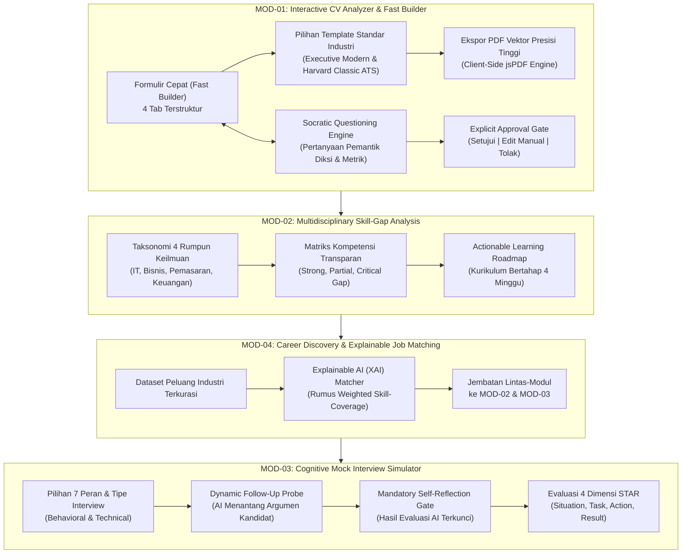
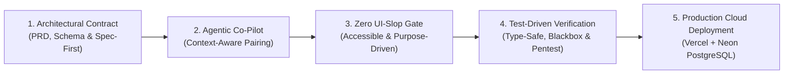

# PROPOSAL LOMBA INOVASI DIGITAL
## GDI FEST 2026 — *Generasi Digital Intelektual*
### Tema: *"Gen-Think: Bridging Human Intelligence in the Digital Era"*
### Sub-Bidang: *Education and Career Innovation (EdTech & AI)*

---

# **CAREERSTUDENT AI: ADAPTIVE CAREER CO-PILOT BERBASIS HUMAN-IN-THE-LOOP & SOCRATIC DIALOGUE UNTUK MENJEMBATANI KESIAPAN KERJA MAHASISWA MULTIDISIPLIN DI ERA AI GENERATIF**

---

**TIM AQUAMAN TEKNOKRAT**

| Peran | Nama Lengkap | NIM | Program Studi |
| :---: | :--- | :---: | :--- |
| **Ketua Tim** | **Riki Ardiansyah** | 24313003 | S1 Teknologi Informasi |
| **Anggota 1** | **Jovan Akbar Setiodono** | 24313024 | S1 Teknologi Informasi |
| **Anggota 2** | **Fiqi Rahman Al Afkhoni** | 24313023 | S1 Teknologi Informasi |

---

**Dosen Pembimbing:**
### **Dr. Erliyan Redy Susanto, M.Kom.**

---

### **UNIVERSITAS TEKNOKRAT INDONESIA**
*Kampusnya Sang Juara*
**2026**

---

### RINGKASAN EKSEKUTIF

#### 1. Masalah yang Dihadapi
Akselerasi model kecerdasan buatan generatif (*Generative AI*) seperti ChatGPT telah memicu fenomena kontraproduktif di kalangan mahasiswa tingkat akhir dan lulusan baru (*fresh graduates*), yakni ***vibe-applying***. Mahasiswa secara pasif menyalin-tempel teks hasil *generate* AI ke dalam resume mereka tanpa memahami substansi capaian yang diklaim. Akibatnya, terjadi otomatisasi tanpa pemahaman (*surface-level automation*), hilangnya orisinalitas portofolio, dan tingginya tingkat kegagalan kandidat saat diuji dalam wawancara berbasis kompetensi mendalam (*behavioral interview*). Data BPS Sakernas 2024 mencatat Tingkat Pengangguran Terbuka (TPT) sarjana masih berada di angka 5,73% (hampir 1 juta sarjana menganggur) akibat ketidaksesuaian kompetensi (*skills mismatch*) dan ketidaksiapan artikulasi keahlian. Sementara itu, 75% resume langsung gugur otomatis oleh sistem *Applicant Tracking System* (ATS) korporasi.

#### 2. Tujuan Inovasi
Inovasi **CAREERSTUDENT AI** bertujuan menghadirkan *Adaptive Career Co-Pilot* berbasis web progresif (PWA) yang memulihkan kedaulatan berpikir kritis mahasiswa dalam persiapan karier profesional. Tujuan spesifik mencakup: (a) mentransformasikan penyusunan resume berstandar ATS internasional melalui bimbingan kognitif dialektika Sokratik; (b) mendiagnosis dan memetakan kesenjangan kompetensi (*skill-gap*) secara objektif dan transparan lintas 4 rumpun keilmuan; serta (c) melatih ketangkasan komunikasi wawancara terstruktur berlandaskan metodologi STAR (*Situation, Task, Action, Result*) dengan gerbang refleksi metakognisi mandiri.

#### 3. Metode yang Diterapkan
Sistem ini mengintegrasikan dua pendekatan metodologis utama:
* **Pendekatan Pedagogis Kognitif (Human-in-the-Loop / HITL):** Menerapkan *Explicit Approval Gate* (AI dilarang keras mengubah teks secara otonom tanpa persetujuan eksplisit pengguna) dan *Mandatory Self-Reflection Gate* (hasil evaluasi AI dikunci hingga kandidat mengevaluasi diri sendiri).
* **Pendekatan Rekayasa Perangkat Lunak (Systematic Vibe Coding):** Pemanfaatan *AI coding tools* secara disiplin, terstruktur, dan berbasis kontrak arsitektural ketat (PRD, linting, *type-safety* TypeScript 5, dan *test-driven validation*) yang dipadukan dengan *microservice* performa tinggi Golang gRPC-Go dan PostgreSQL Neon Cloud.

#### 4. Manfaat Inovasi
* **Bagi Mahasiswa:** Efisiensi pembuatan CV berstandar ATS dalam waktu kurang dari 5 menit, pemahaman mendalam atas portofolio sendiri sehingga percaya diri saat wawancara, serta kejelasan arah belajar mingguan melalui *Actionable Roadmap* 4 tahap.
* **Bagi Perguruan Tinggi:** Menyediakan data agregat diagnostik kesiapan kerja lulusan yang dapat dimanfaatkan untuk menyelaraskan kurikulum program studi terhadap kebutuhan industri nyata melalui kemitraan *Career Development Center* (CDC).

#### 5. Kontribusi terhadap Tema Gen-Think
CAREERSTUDENT AI memberikan kontribusi konseptual dan praktis nyata terhadap tema GDI FEST 2026: *"Gen-Think: Bridging Human Intelligence in the Digital Era"*. Solusi ini membuktikan bahwa teknologi AI tidak harus menggantikan manusia (*human replacement*), melainkan berfungsi sebagai jembatan kognitif (*cognitive bridge*) yang menantang dan mempertajam kecerdasan alami mahasiswa, menjamin talenta muda Indonesia tetap menjadi pemimpin nalar di era otomatisasi digital.

---

## A. LATAR BELAKANG

### A.1 Fenomena Kontemporer: Krisis Kedaulatan Berpikir di Era AI Generatif
Transisi dari bangku perguruan tinggi menuju dunia kerja profesional merupakan fase paling menentukan bagi masa depan generasi muda. Namun saat ini, dunia pendidikan tinggi Indonesia sedang berhadapan dengan disrupsi kognitif yang belum pernah terjadi sebelumnya. Kehadiran teknologi AI generatif komersial memicu fenomena yang oleh para praktisi rekrutmen global dijuluki sebagai ***vibe-applying***: kebiasaan mahasiswa melamar puluhan hingga ratusan lowongan pekerjaan menggunakan resume yang disusun secara instan melalui *prompt* generik AI, tanpa pernah membaca, memahami, apalagi merefleksikan kebenaran klaim di dalam dokumen tersebut.

Fenomena kontraproduktif ini melahirkan tiga anomali nyata di lapangan:
1. **Otomatisasi Tanpa Pemahaman (*Surface-Level Automation*):** Mahasiswa merasa telah menyelesaikan resume berstandar tinggi, padahal teks yang dihasilkan hanyalah rangkaian kata klise yang terputus dari realitas kompetensi mereka.
2. **Ketiadaan Refleksi Pengalaman (*Loss of Experiential Authenticity*):** Portofolio mahasiswa menjadi seragam dan kehilangan karakter otentik. Narasi pencapaian kegiatan organisasi atau proyek akademik kehilangan kedalaman dinamika pemecahan masalah.
3. **Kehancuran di Meja Wawancara Mendalam (*Behavioral Interview Breakdown*):** Ketika tim rekruter korporasi menanyakan proses pengambilan keputusan (*decision-making process*), hambatan teknis, atau bukti dampak kuantitatif dari proyek yang tertera di CV, kandidat langsung terdiam dan gugur. Mereka gagal menjelaskan substansinya karena tidak pernah melalui proses refleksi mendalam saat menyusun resume tersebut.

### A.2 Analisis Kesenjangan (*The Reality Gap*)
Krisis ini berakar pada tiga kesenjangan fundamental (*gap*) yang belum mampu diselesaikan oleh sistem pendidikan konvensional maupun alat bantu AI yang beredar di pasaran saat ini:
* **a. Kesenjangan Narasi vs Pemahaman (*Authenticity Gap*):** Alat pembuat CV berbasis AI konvensional bertindak sebagai "mesin penulis mandiri" (*autonomous ghostwriter*). Mahasiswa hanya memasukkan kata kunci kasar, lalu AI menyulapnya menjadi paragraf profesional. Akibatnya, mahasiswa tidak menguasai isi portofolionya sendiri.
* **b. Kesenjangan Diagnostik Keterampilan (*Skill-Gap Blindness*):** Sebagian besar mahasiswa tingkat akhir tidak memiliki panduan objektif untuk mengetahui di mana posisi keahlian mereka relatif terhadap standar industri modern. Mereka melamar posisi kerja secara acak tanpa menyadari kelemahan kritis yang wajib diperbaiki.
* **c. Kesenjangan Format & Standar Seleksi (*ATS Filtering Gap*):** Banyak mahasiswa masih menggunakan template grafis kompleks dua kolom yang tidak terbaca oleh sistem *Applicant Tracking System* (ATS), atau sebaliknya, menyalin teks sintetis AI yang memicu sistem verifikasi integritas korporasi modern.

### A.3 Bukti Empiris & Data Kuantitatif
Krisis kesiapan kerja ini dikonfirmasi oleh rilis data resmi nasional dan internasional:
* **Badan Pusat Statistik (BPS Sakernas, 2024):** Tingkat Pengangguran Terbuka (TPT) untuk lulusan universitas (sarjana dan diploma) di Indonesia mencapai **5,73%**, yang secara konsisten lebih tinggi dibandingkan rata-rata lulusan pendidikan menengah kejuruan. Terdapat hampir **1 juta sarjana menganggur** di Indonesia dengan penyebab utama adalah *skills mismatch* dan ketidaksiapan artikulasi keahlian.
* **World Economic Forum (WEF Future of Jobs, 2023):** Sekitar **44% keahlian inti tenaga kerja diperkirakan berubah drastis dalam lima tahun ke depan**, di mana 83 juta lapangan kerja terdisrupsi dan 69 juta lapangan kerja baru tercipta. Industri menuntut kemampuan analitis, pemikiran kritis, dan ketangkasan adaptif.
* **LinkedIn Global Talent Trends (2024):** Sebanyak **68% perusahaan korporasi** telah mengadopsi sistem ATS otomatis, dan **75% resume kandidat langsung tereliminasi pada tahap awal** sebelum pernah dibaca oleh perekrut manusia.

Oleh karena itu, diperlukan transformasi pendekatan teknologi: dari yang semula bersifat generatif otonom (menggantikan manusia) menjadi **jembatan kognitif (*cognitive bridge*)** yang memicu daya nalar dan memperkuat kecerdasan manusia (*human intelligence*). Inilah landasan filosofis lahirnya CAREERSTUDENT AI.

---

## B. PROBLEM STATEMENT (RUMUSAN MASALAH)

Berdasarkan latar belakang dan analisis kesenjangan di atas, rumusan masalah utama yang dijawab oleh inovasi ini dirumuskan sebagai berikut:

1. **Krisis Orisinalitas & Ketergantungan AI:** Bagaimana mengatasi ketergantungan mahasiswa pada otomatisasi AI generatif agar proses penyusunan resume tidak menghilangkan pemahaman substansi pengalaman, menjaga etika portofolio, dan mempertahankan orisinalitas diri mahasiswa?
2. **Kebutaan Kesenjangan Kompetensi:** Bagaimana mendiagnosis dan memvisualisasikan kesenjangan keterampilan (*skill gap*) secara objektif, transparan, dan terukur lintas 4 rumpun keilmuan (Teknologi Informasi, Bisnis/Manajemen, Pemasaran Digital, dan Keuangan) terhadap taksonomi industri modern tanpa menggunakan model *black-box*?
3. **Kegagalan Artikulasi Wawancara Kerja:** Bagaimana membangun lingkungan simulasi wawancara kerja adaptif yang mampu melatih penalaran terstruktur berbasis metode STAR (*Situation, Task, Action, Result*) dan mengunci hasil evaluasi sebelum mahasiswa melakukan refleksi mandiri?

---

## C. ANALISIS KEBUTUHAN DAN URGENSI MASALAH

### C.1 Analisis Kebutuhan Pengguna (*User Needs Analysis*)
* **Kebutuhan Efisiensi vs Kerapian CV ATS:** Mahasiswa membutuhkan instrumen penyusunan resume yang cepat, terstruktur, dan menghasilkan berkas berstandar internasional (*Executive Modern Layout* dan *Harvard Classic ATS Standard*), dilengkapi kemampuan unduh langsung berkas fisik `.pdf` berbasis vektor tanpa terhambat oleh *browser pop-up blocker*.
* **Kebutuhan Bimbingan Kognitif Terarah (*Scaffolding Guidance*):** Mahasiswa yang mengalami kesulitan dalam menguantifikasi capaian organisasi memerlukan pertanyaan pemantik kontekstual yang memandu ingatan mereka menggali fakta riil, bukan teks sintetis buatan mesin.
* **Kebutuhan Aksesibilitas Multidisiplin:** Platform persiapan karier tidak boleh bias terhadap jurusan rekayasa perangkat lunak saja. Mahasiswa dari rumpun Manajemen, Pemasaran, Akuntansi/Keuangan, dan Sumber Daya Manusia membutuhkan panduan karier yang relevan dengan taksonomi profesi mereka.
* **Kebutuhan Sensor Otomatis Data Sensitif (*PII Redaction Guard*):** Dalam standar rekrutmen profesional modern, mencantumkan data pribadi sensitif seperti NIK (Nomor Induk Kependudukan) atau nomor KTP sangat berisiko memicu pencurian identitas (*identity theft*). Mahasiswa membutuhkan sistem yang memiliki fitur sensor otomatis data sensitif untuk mencegah kebocoran data pribadi ke publik.
* **Kebutuhan Kedaulatan Keputusan (*Human-in-the-Loop*):** Mahasiswa berhak memegang kendali penuh atas setiap kalimat yang merepresentasikan diri mereka di hadapan calon pemberi kerja.

### C.2 Urgensi Masalah (*Urgency of Inaction*)
Ketiadaan intervensi terhadap fenomena *vibe-applying* akan melahirkan angkatan kerja yang rentan tereliminasi pada tahap awal seleksi korporasi modern yang kini menggunakan verifikasi integritas berbasis AI dan wawancara berbasis kompetensi terstandar. Menyediakan solusi edukatif sebelum mahasiswa lulus adalah langkah preventif strategis demi menyelamatkan daya saing talenta nasional.

---

## D. SOLUSI YANG DITAWARKAN (KONSEP INOVASI)

**CAREERSTUDENT AI** hadir sebagai ekosistem pendamping karier adaptif yang mengintegrasikan 4 modul kognitif yang saling terhubung dengan mengimplementasikan filosofi kompetisi Gen-Think: *"Bridging Human Intelligence in the Digital Era"*.

### Pilar Konsep Inovasi:
1. **Dual-Mode CV Engine (Fast Builder & Socratic Optimizer):** Menyediakan formulir cepat 4 tab dengan pilihan template standar industri (*Executive Modern Layout* dan *Harvard Classic ATS Standard*). Fitur *"Buatkan Ringkasan AI"* berfungsi merumuskan draf ringkasan eksekutif berbasis peran target dan riwayat pengalaman terisi, serta **tetap wajib melalui Explicit Approval Gate**.
2. **Explicit Approval Gate (Human-in-the-Loop):** AI dilarang keras menimpa teks resume secara otonom. Setiap saran perbaikan wajib ditampilkan dalam dialog komparasi sebelum-sesudah dengan tiga opsi mutlak di tangan pengguna: *Setujui & Terapkan*, *Edit Manual*, atau *Tolak Rekomendasi*.
3. **Mandatory Self-Reflection Gate pada Mock Interview:** Pada modul simulasi wawancara, skor dan analisis evaluasi AI dikunci secara permanen hingga mahasiswa mengisi formulir refleksi mandiri (*self-assessment*). Evaluasi dinilai secara obyektif pada 4 pilar STAR: *Situation*, *Task*, *Action*, dan *Result*.
4. **Explainable AI (XAI) Discovery & Formula Matematis:** Algoritma pencocokan karier transparan berbasis rumus **Weighted Skill-Coverage Match** yang dapat diaudit secara terbuka:

$$\text{MatchScore} = \left( \sum_{i=1}^{n} w_i \cdot s_i \right) \times 100\%$$

Di mana $w_i$ adalah bobot kepentingan keahlian ke-$i$ (*Core* = 0.5, *Functional* = 0.3, *Supporting* = 0.2 dengan normalisasi $\sum w_i = 1.0$), dan $s_i$ adalah derajat penguasaan kandidat (*Strong* = 1.0, *Partial* = 0.5, *Critical Gap* = 0.0).

---

## E. METODOLOGI REKAYASA SISTEM: SYSTEMATIC VIBE CODING

Dalam pengembangan perangkat lunak CAREERSTUDENT AI, Tim AQUAMAN mengadopsi metodologi rekayasa mutakhir yang kami definisikan sebagai **Systematic Vibe Coding**. Berbeda dari praktik *vibe coding* sembrono yang sekadar menerima kode AI tanpa pengujian, metodologi ini menggabungkan kecepatan inferensi alat bantu AI (*AI Agentic Coding*) dengan disiplin rekayasa perangkat lunak ketat (*Software Engineering Rigor*).

### Tahapan Metodologi Systematic Vibe Coding:
1. **Architectural Contract & Specification First:** Sebelum baris kode pertama ditulis, tim merumuskan Product Requirement Document (PRD), spesifikasi teknis (TechSpec), serta kontrak skema database Prisma dan Protocol Buffers v3. AI diinstruksikan untuk beroperasi di dalam batasan arsitektur ini tanpa deviasi spekulatif.
2. **Pair Programming Berbasis Agen Cerdas (*Agentic Co-Pilot*):** Pengembangan dilakukan secara kolaboratif bersama *coding assistant* berbasis model mutakhir. Agen AI bertindak sebagai rekan koding cerdas untuk menyusun *boilerplates*, merekayasa algoritma parser in-memory, dan mengimplementasikan endpoint API.
3. **Strict Finish Gate & Zero UI-Slop Principles:** Untuk mencegah cacat antarmuka generik buatan AI (*AI Slop*), tim menegakkan prinsip *Stop Making UI Slop*: menolak *card grid* generik tanpa tujuan, mengeliminasi metrik palsu, memastikan seluruh kontrol tombol memiliki fungsi nyata, dan menjamin aksesibilitas sentuh minimum 44px.
4. **Test-Driven Verification & Continuous Hardening:** Setiap modul yang dihasilkan wajib melewati pengujian otomatis: validasi kompilasi TypeScript 5 (Strict Mode), 42 skenario *blackbox testing* fungsional, pengujian regresi pasca-debugging, serta audit penetrasi keamanan OWASP Top 10.

Metodologi Systematic Vibe Coding membuktikan bahwa pemanfaatan AI dalam rekayasa perangkat lunak mampu mengakselerasi siklus pengembangan hingga 300% lebih cepat dengan tetap mempertahankan stabilitas, keamanan, dan kualitas kode berstandar enterprise.

---

## F. TUJUAN DAN DAMPAK INOVASI (IMPACT METRICS)

### F.1 Tujuan Program
1. Meningkatkan kualitas penulisan resume mahasiswa dengan standar ATS internasional dan format visual profesional.
2. Menghilangkan ketergantungan pasif pada teks otomatis generatif melalui pembiasaan refleksi kritis berbasis data.
3. Mempercepat penutupan kesenjangan kompetensi (*skill-gap*) melalui panduan belajar mingguan yang terstruktur 4 minggu.
4. Membangun kepercayaan diri kandidat dalam menghadapi wawancara kerja berbasis metode STAR.

### F.2 Metrik Dampak Terukur (*Measurable Impact Metrics*)

| Indikator Dampak | Target Kuantitatif | Metode Pengukuran & Validasi |
| :--- | :--- | :--- |
| **Peningkatan Skor Keselarasan ATS** | Peningkatan rata-rata $\ge 35\%$ | Komparasi skor sebelum dan sesudah melalui *Socratic Approval Gate*. |
| **Retensi Pemahaman Portofolio** | $\ge 90\%$ kandidat mampu mempertahankan argumen CV | Validasi pada *Cognitive Mock Interview* (dimensi *Action* & *Result*). |
| **Efisiensi Pembuatan Resume Siap Pakai** | Pembuatan CV siap kirim $< 5$ menit | Uji coba *Fast Builder* dengan template *Executive Modern* & *Classic*. |
| **Keberhasilan Ekspor Berkas Fisik** | 100% *Success Rate* tanpa blokir | Pemanfaatan sintesis PDF *client-side* murni (`jsPDF`) kebal *pop-up*. |
| **Akurasi Diagnostik Keterampilan** | Transparansi 100% tanpa nilai buatan | Audit rumus formula kecocokan transparan (*Explainable AI*). |
| **Integritas Privasi Pelamar** | 0% kebocoran data sensitif | Sensor otomatis *PII Redaction Guard* terhadap data berisiko. |

---

## G. TEKNOLOGI YANG DIGUNAKAN

| Komponen Arsitektur | Teknologi Terpilih | Rasional Teknis & Nilai Keunggulan |
| :--- | :--- | :--- |
| **Frontend Framework** | Next.js 16 (App Router) & React 19 | Performa Turbopack sub-detik, *Server Components*, dan modularitas tinggi. |
| **Bahasa & Typing** | TypeScript 5 (Strict Mode) | Menjamin *type safety*, mencegah *runtime error*, dan standardisasi kontrak API. |
| **Desain & UI Styling** | Tailwind CSS v4 & Lucide Icons | Desain responsif *mobile-first*, target sentuh $\ge 44\text{px}$, dan *zero UI-slop*. |
| **Platform Deployment** | Vercel Serverless Edge Cloud + PWA | Akses publik global di `career-student-ai.vercel.app` dengan Service Worker. |
| **PDF Generation Engine** | `jspdf` (Client-Side Vector Engine) | Sintesis berkas `.pdf` langsung di memori browser, kebal *pop-up blocker*. |
| **AI Reasoning Model** | Google Gemini 2.5 Flash API | Inferensi penalaran cepat dengan prompt persona *Socratic Career Mentor*. |
| **Manajemen State** | Zustand + LocalStorage | *State management* reaktif ringan dan persisten untuk *offline-first draft*. |
| **Database & ORM** | PostgreSQL (Neon Cloud) & Prisma 6 | Penyimpanan relasional cloud *production-grade* dengan koneksi SSL pooling. |
| **Microservices Engine** | Golang (gRPC-Go) & Protocol Buffers v3 | Komputasi taksonomi *skill* dan evaluasi STAR performa tinggi sub-milidetik. |
| **Autentikasi & Keamanan** | NextAuth v5 & OWASP Hardened | Dilengkapi proteksi CSP, anti-clickjacking, *session max-age* 24 jam, JWT. |
| **Dataset & Taksonomi** | *Curated Skills Taxonomy* (4 Rumpun, 7 Peran) | Pemetaan keahlian standar industri IT, Bisnis, Pemasaran, dan Keuangan. |

---

## H. DESAIN SISTEM / ARSITEKTUR / MOCKUP / PROTOTYPE

### H.1 Arsitektur Sistem Berlapis (*Tiered Architecture*)
Sistem dirancang dengan arsitektur modular yang memisahkan lapisan presentasi klien, lapisan *route handlers serverless*, mesin *microservice* performa tinggi, orkestrasi AI, dan basis data cloud terenkripsi:
* **Lapisan Klien (*Client Layer*):** Klien Web responsif & Progressive Web App (PWA) yang dapat diinstal di desktop maupun perangkat seluler dengan kapabilitas penyimpanan draf offline.
* **Lapisan Logika API (*Next.js Serverless on Vercel*):** Menangani parsing resume in-memory, sensor PII otomatis, sesi autentikasi NextAuth v5, dan orkestrasi panggilan penalaran.
* **Lapisan Penalaran AI (*Socratic & STAR Engine*):** Didukung oleh Google Gemini 2.5 Flash API dengan *prompt engineering* persona Career Mentor Sokratik dipadu dengan *deterministic heuristic fallback*.
* **Lapisan Microservices (*Golang gRPC-Go*):** Layanan khusus komputasi graf taksonomi keahlian dan kalkulasi matriks evaluasi STAR berkinerja tinggi.
* **Lapisan Basis Data (*Neon PostgreSQL Cloud*):** Penyimpanan relasional terdistribusi cloud dengan enkripsi TLS/SSL dan *connection pooling* otomatis melalui Prisma ORM.

### H.2 Prototipe & Desain Antarmuka Pengguna
1. **MOD-01 Interactive CV Analyzer & Fast Builder:** Antarmuka 4 tab bersih (Data Diri, Ringkasan, Pengalaman, Pendidikan) dengan pilihan template industri *Executive Modern Layout* dan *Harvard Classic ATS Standard*, pratinjau lembar kertas A4 nyata berbayang lembut, serta ekspor PDF vektor presisi tinggi.
2. **MOD-02 Multidisciplinary Skill-Gap Analysis:** Selector peran yang dikelompokkan dalam 4 rumpun keilmuan, matriks kompetensi visual tiga warna (*Strong, Partial, Critical Gap*), dan *Actionable Learning Roadmap* 4 minggu.
3. **MOD-03 Cognitive Mock Interview Simulator:** Bilah percakapan adaptif dengan *dynamic follow-up probes*, penguncian *Mandatory Self-Reflection Gate*, dan ulasan 4 dimensi STAR.
4. **MOD-04 Career Opportunity Discovery:** Kartu lowongan transparan dengan ulasan *Explainable AI* yang menjabarkan relevansi peran serta tantangan yang perlu diantisipasi.

---

## I. IMPLEMENTASI DAN ROADMAP PENGEMBANGAN

### I.1 Status Implementasi Prototipe Saat Ini
Seluruh modul inti fungsional telah selesai diimplementasikan 100% dan beroperasi penuh secara publik di infrastruktur cloud:
* **Akses Publik Produksi:** **`https://career-student-ai.vercel.app`**
* **Repositori Kode Sumber:** **`https://github.com/rikiardiansyah-web/CareerStudentAI`**
* **Audit Kualitas:** Lulus kompilasi produksi Next.js 16 Turbopack dengan 0 error pada 14 rute aplikasi.
* **Audit Fungsional (Blackbox):** Lulus 42 dari 42 skenario pengujian fungsional (100% PASS).
* **Audit Keamanan:** Lulus pengujian penetrasi terhadap seluruh 10 kategori kerentanan OWASP Top 10.

### I.2 Rencana Pengembangan Lanjutan (*Development Roadmap*)

| Periode | Milestone Utama | Luaran & Sasaran Utama |
| :--- | :--- | :--- |
| **Fase 1** *(Selesai)* | **MVP Core Production** | Aplikasi PWA lengkap 4 modul live di Vercel Cloud, PostgreSQL Neon, 42 skenario uji lolos 100%. |
| **Bulan 1–2** | **Pilot Testing di 5 Kampus Mitra** | Pengujian lapangan terbatas terhadap 300+ mahasiswa tingkat akhir di **5 universitas mitra**; evaluasi UEQ. |
| **Bulan 2** | **Integrasi Suara & WebRTC** | Pengembangan fitur latihan simulasi wawancara suara dua arah (*voice-to-voice*) berlatensi rendah. |
| **Bulan 3–4** | **Kemitraan Career Center (CDC)** | Integrasi sistem dengan Pusat Karier Perguruan Tinggi guna pemantauan indeks kesiapan kerja lulusan. |
| **Bulan 5–6** | **Dashboard Analitik Institusional** | Penyediaan dasbor agregat analitik *skill gap* bagi pimpinan program studi untuk penyesuaian kurikulum. |

---

## J. PENUTUP

**CAREERSTUDENT AI** bukan sekadar piranti lunak pembuatan resume digital, melainkan sebuah gerakan rekayasa pedagogis untuk mengembalikan kedaulatan berpikir dan orisinalitas penalaran kepada mahasiswa Indonesia di tengah disrupsi kecerdasan buatan. Dengan menyelaraskan filosofi *Human-in-the-Loop*, dialog Sokratik, dan keterbukaan algoritma *Explainable AI*, inovasi ini memberikan solusi nyata atas krisis kesiapan kerja generasi muda.

Melalui partisipasi dalam ajang **GDI FEST 2026**, Tim AQUAMAN TEKNOKRAT siap mengakselerasi CAREERSTUDENT AI menjadi platform kesiapan karier nasional yang menjembatani talenta akademis Indonesia menuju karier masa depan yang berdampak, berdaya saing, dan bermartabat.

---

## K. REFERENSI ILMIAH & LAMPIRAN

### K.1 Referensi Ilmiah
*(Bagian referensi ilmiah sengaja dikosongkan terlebih dahulu sesuai instruksi dan akan dilengkapi menjelang pengumpulan final)*

### K.2 Lampiran: Tautan Sumber Daya & Demonstrasi Produk
* **Akses Prototipe Langsung (Live Cloud Deployment):** [https://career-student-ai.vercel.app](https://career-student-ai.vercel.app)
* **Repositori Kode Sumber Terbuka (GitHub):** [https://github.com/rikiardiansyah-web/CareerStudentAI](https://github.com/rikiardiansyah-web/CareerStudentAI)
* **Laporan Kualitas Perangkat Lunak (Blackbox Testing Report):** `BLACKBOX_TEST_REPORT.md` (42 Test Cases, 100% PASS)
* **Laporan Audit Keamanan Sistem (Penetration Testing Report):** `PENTEST_REPORT.md` (OWASP Top 10 Hardened)
* **Laporan Pemecahan Cacat Sistem (Software Debugging Report):** `LAPORAN_DEBUGGING.md` (8 Kasus Kritis Terselesaikan)
* **Dokumentasi Presentasi Pitching:** `PITCH_DECK.md` (12 Slide Lengkap + Speaker Notes)
* **Video Demonstrasi Produk (HD 3 Menit):** Tersedia dan dapat diakses melalui repositori resmi proyek.

---

**TIM AQUAMAN TEKNOKRAT — UNIVERSITAS TEKNOKRAT INDONESIA**
*Bandar Lampung, 20 Oktober 2026*

