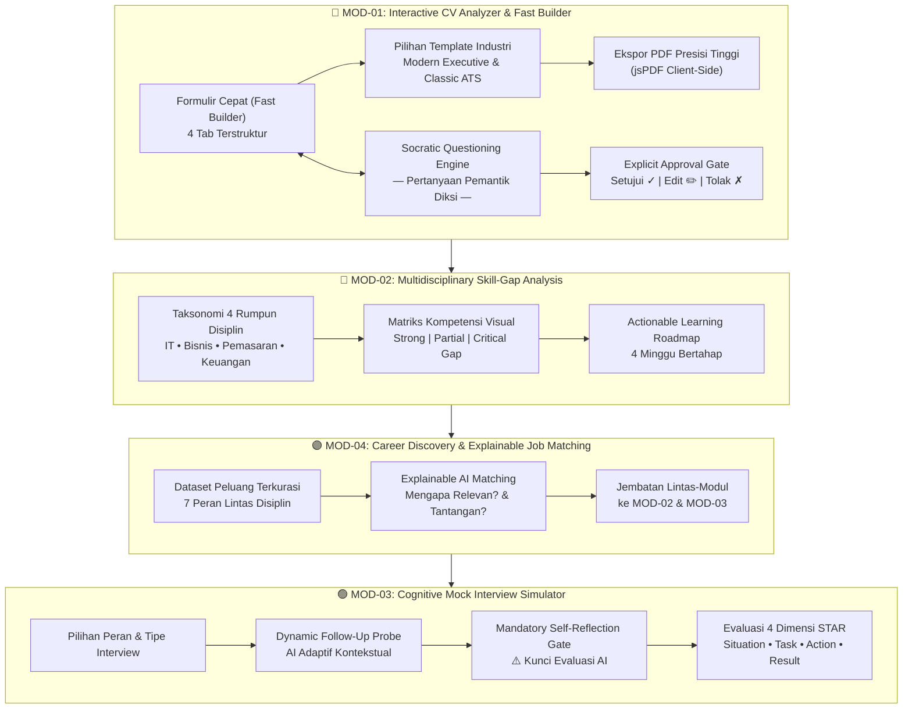
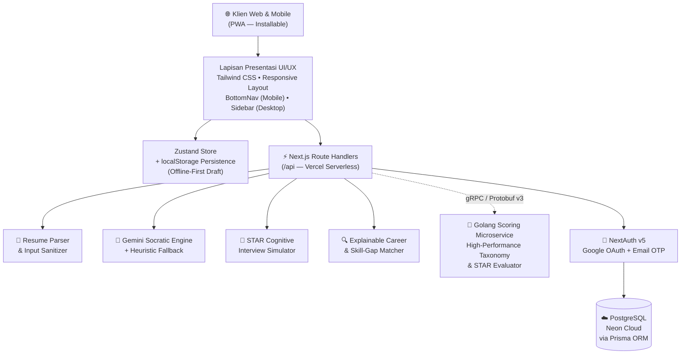
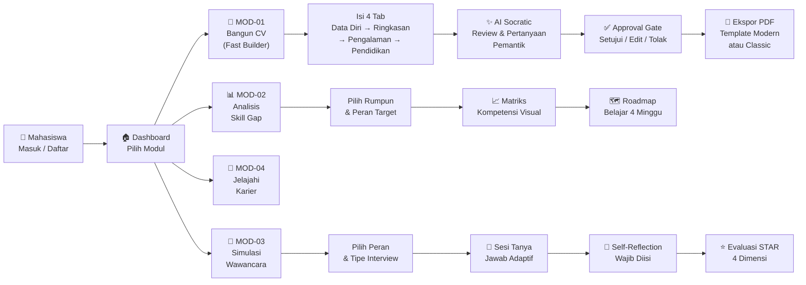
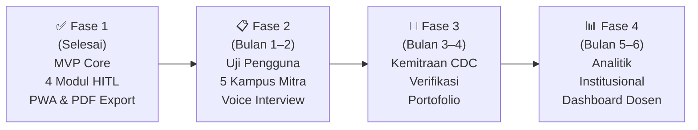

# PROPOSAL LOMBA INOVASI DIGITAL
## GDI FEST 2026 — *Generasi Digital Intelektual*
### Tema: *"Gen-Think: Bridging Human Intelligence in the Digital Era"*

---

# **CAREERSTUDENT AI**
### *Adaptive Career Co-Pilot Berbasis Human-in-the-Loop & Socratic Dialogue untuk Menjembatani Kesiapan Kerja Mahasiswa di Era Disrupsi Kecerdasan Buatan*

---

**Bidang Inovasi:** Artificial Intelligence & Teknologi Digital

---

### TIM AQUAMAN

| Peran | Nama Lengkap | NIM | Program Studi |
|:---:|:---|:---:|:---|
| **Ketua Tim** | **Riki Ardiansyah** | 24313003 | S1 Teknologi Informasi |
| Anggota 1 | Jovan Akbar Setiodono | 24313024 | S1 Teknologi Informasi |
| Anggota 2 | Fiqi Rahman Al Afkhoni | 24313023 | S1 Teknologi Informasi |

---

### **UNIVERSITAS TEKNOKRAT INDONESIA**
**2026**

---

## 1. LATAR BELAKANG

### *Ketika Mesin Berpikir Menggantikan Manusia yang Berhenti Berpikir*

Indonesia sedang menghadapi paradoks yang tidak pernah dibayangkan sebelumnya. Di satu sisi, revolusi kecerdasan buatan generatif (*Generative AI*) menjanjikan percepatan produktivitas hingga 40% di berbagai sektor industri (McKinsey Global Institute, 2023). Di sisi lain, kemudahan ini justru menciptakan **generasi yang kehilangan kemampuan paling mendasar: berpikir kritis tentang dirinya sendiri.**

Bayangkan skenario berikut — yang bukan lagi fiksi, melainkan realitas sehari-hari di kampus-kampus seluruh Indonesia:

> *Seorang mahasiswa tingkat akhir membuka ChatGPT, mengetik "buatkan CV untuk posisi Data Analyst", menyalin hasilnya tanpa membaca, dan mengirimkannya ke 50 perusahaan. Ketika dipanggil wawancara, pewawancara bertanya: "Anda menulis bahwa Anda meningkatkan efisiensi proses 30%. Bisa ceritakan bagaimana caranya?" Mahasiswa itu terdiam — karena angka itu bukan miliknya. Kalimat itu bukan pengalamannya. Bahkan ia tidak ingat pernah menulisnya.*

Fenomena ini kini memiliki nama: ***vibe-applying*** — melamar kerja berdasarkan "vibes" teks hasil AI, tanpa substansi pengalaman nyata di baliknya.

**World Economic Forum (WEF)** dalam *Future of Jobs Report 2023* memproyeksikan bahwa **44% keterampilan inti pekerja akan berubah dalam lima tahun ke depan.** Artinya, mahasiswa yang lulus hari ini tidak hanya harus bersaing dengan sesama manusia — mereka harus bersaing dengan mesin yang mampu menghasilkan teks, kode, dan analisis dalam hitungan detik. Dalam kompetisi seketat ini, satu-satunya keunggulan yang tidak dapat direplika oleh mesin adalah **keaslian pengalaman** dan **kedalaman penalaran kritis**.

Namun data nasional menunjukkan gambaran yang mengkhawatirkan. **Badan Pusat Statistik (BPS, 2024)** mencatat Tingkat Pengangguran Terbuka (TPT) untuk lulusan universitas di Indonesia masih mencapai **5,73%** — angka yang secara konsisten lebih tinggi dibandingkan lulusan SMK. Penyebab utamanya bukan kurangnya ijazah, melainkan ***skills mismatch***: ketidaksesuaian antara apa yang diajarkan kampus dengan apa yang dibutuhkan industri.

Lebih mengkhawatirkan lagi, survei **LinkedIn Economic Graph (2024)** mengungkapkan bahwa **68% perekrut korporasi** kini menggunakan sistem **Applicant Tracking System (ATS)** untuk menyaring kandidat secara otomatis — dan **75% resume ditolak sebelum dibaca manusia** karena gagal memenuhi standar format dan diksi yang dikenali ATS. Mahasiswa yang tidak memahami cara kerja sistem ini secara literal **tidak pernah mendapat kesempatan untuk dilihat**, sekeras apa pun mereka berusaha.

Jika tidak ada intervensi, inilah yang akan terjadi:

- **Generasi *copy-paste* yang tidak bisa mempertanggungjawabkan isi CV mereka sendiri** saat wawancara mendalam (*behavioral interview*).
- **Angka pengangguran terdidik yang terus membengkak** karena mahasiswa mengirim puluhan lamaran generik tanpa memahami kesenjangan kompetensi (*skill gap*) mereka.
- **Erosi kepercayaan industri terhadap kualitas lulusan perguruan tinggi**, yang pada akhirnya menurunkan nilai tawar seluruh sistem pendidikan tinggi Indonesia.
- **Hilangnya kemandirian berpikir kritis** — keterampilan yang justru menjadi pembeda antara pekerja yang tergantikan mesin dan yang memimpin mesin.

Oleh karena itu, teknologi tidak boleh menjadi pengganti pikiran manusia. Teknologi harus menjadi **jembatan kognitif** (*cognitive bridge*) — alat yang memicu, membimbing, dan memperkuat kecerdasan manusia. Inilah filosofi yang menjiwai **CAREERSTUDENT AI**: bukan AI yang menggantikan mahasiswa berpikir, melainkan AI yang **memaksa mahasiswa untuk berpikir lebih tajam dari sebelumnya**.

---

## 2. PROBLEM STATEMENT (RUMUSAN MASALAH)

Berdasarkan analisis latar belakang di atas, tiga rumusan masalah utama yang dijawab oleh inovasi ini adalah:

### Masalah 1: Krisis Orisinalitas — *Ketika CV Bukan Milik Penulisnya*
> **Bagaimana merancang sistem penyusunan resume berbasis AI yang justru memperkuat — bukan menggantikan — pemahaman substansi pengalaman dan orisinalitas diri mahasiswa?**

Mahasiswa saat ini terperangkap dalam paradoks: semakin canggih alat AI yang mereka gunakan untuk membuat CV, semakin dangkal pemahaman mereka tentang isi CV tersebut. Resume berubah dari dokumen refleksi personal menjadi teks generik yang dihasilkan mesin — indah di permukaan, kosong di substansi. Ketika pewawancara menggali detail pengalaman yang tertulis, kandidat gagal menjelaskan karena **mereka tidak pernah melalui proses refleksi mendalam**.

### Masalah 2: Kebutaan Kompetensi — *Tidak Tahu Apa yang Tidak Diketahui*
> **Bagaimana mendiagnosis dan memvisualisasikan kesenjangan keterampilan (*skill gap*) secara objektif, terukur, dan transparan lintas disiplin keilmuan terhadap taksonomi industri modern?**

Sebagian besar mahasiswa tidak mengetahui secara presisi **di mana letak kelemahan kompetensi mereka** relatif terhadap standar industri. Mereka melamar posisi yang tidak sesuai, mengabaikan keterampilan kritis yang seharusnya dikuasai, dan tidak memiliki peta jalan (*roadmap*) untuk menutup kesenjangan tersebut. Tanpa diagnosis yang akurat, setiap upaya peningkatan diri menjadi **tembakan buta tanpa target**.

### Masalah 3: Kegagalan di Ruang Wawancara — *Menang di Kertas, Kalah di Meja*
> **Bagaimana membangun lingkungan simulasi wawancara kerja yang adaptif dan kognitif, yang mampu melatih penalaran terstruktur berbasis metode STAR dan mendorong metakognisi melalui refleksi mandiri sebelum evaluasi?**

Bahkan ketika berhasil melewati penyaringan ATS, mahasiswa seringkali gagal di tahap wawancara karena **ketidakmampuan mengartikulasikan pengalaman secara terstruktur**. Mereka menjawab pertanyaan dengan cerita yang bertele-tele, melompat-lompat kronologis, dan tidak mampu menunjukkan dampak konkret dari tindakan mereka. Tidak ada ruang latihan yang aman (*safe practice environment*) yang mengajarkan mereka **cara berpikir** — bukan hanya **apa yang harus dijawab**.

---

## 3. ANALISIS KEBUTUHAN DAN URGENSI MASALAH

### 3.1 Analisis Kebutuhan Pengguna (*User Needs Analysis*)

Berdasarkan observasi lapangan dan studi literatur, empat kebutuhan mendasar pengguna teridentifikasi:

| No | Kebutuhan Pengguna | Deskripsi | Status Solusi Saat Ini |
|:---:|:---|:---|:---:|
| 1 | **Efisiensi & Kerapian CV berstandar ATS** | Mahasiswa membutuhkan alat yang cepat, tidak membingungkan, dan menghasilkan CV dengan tata letak profesional yang lolos ATS — dilengkapi ekspor `.pdf` langsung tanpa hambatan *pop-up blocker*. | ❌ Tidak tersedia secara terintegrasi |
| 2 | **Bimbingan Kognitif Terarah** | Mahasiswa yang kesulitan menguantifikasi pencapaian membutuhkan pertanyaan pemantik (*scaffolding guidance*) yang membimbing ingatan, **bukan** teks palsu buatan mesin. | ❌ AI generatif justru menghilangkan kebutuhan berpikir |
| 3 | **Aksesibilitas Multidisiplin** | Mahasiswa dari berbagai latar belakang (IT, Manajemen, Pemasaran, Keuangan, SDM) membutuhkan platform yang mengakomodasi jalur karier mereka — bukan hanya peran teknologi. | ❌ Platform yang ada bias ke sektor IT |
| 4 | **Privasi & Kendali Data (*Human-in-the-Loop*)** | Mahasiswa berhak atas perlindungan identitas digital dan kendali mutlak untuk menyetujui, mengedit, atau menolak setiap rekomendasi AI. | ❌ Sebagian besar AI bersifat *black-box* |

### 3.2 Urgensi Masalah — *Apa yang Terjadi Jika Kita Tidak Bertindak Sekarang?*

Jika tidak ada intervensi teknologi edukatif yang dirancang dengan benar, maka:

**🔴 Dalam 1–2 tahun ke depan:**
Generasi lulusan 2026–2027 akan menjadi **angkatan pertama yang sepenuhnya tumbuh di era AI generatif** — dan juga angkatan pertama yang paling rentan terhadap eliminasi pada tahap awal seleksi korporasi modern. Perusahaan-perusahaan besar kini mulai menggunakan **verifikasi integritas berbasis AI** yang mendeteksi resume hasil *copy-paste* dari ChatGPT.

**🔴 Dalam 3–5 tahun ke depan:**
*Skills mismatch* akan semakin melebar. WEF memproyeksikan bahwa **83 juta pekerjaan akan hilang** sementara **69 juta pekerjaan baru akan tercipta** pada 2027 — pekerjaan yang membutuhkan keterampilan yang tidak diajarkan oleh sistem pendidikan tradisional. Mahasiswa tanpa peta kompetensi yang akurat akan semakin tertinggal.

**🔴 Dampak sistemik jangka panjang:**
Kepercayaan industri terhadap kualitas lulusan perguruan tinggi Indonesia akan terdegradasi. Perusahaan akan memilih merekrut talenta asing atau mengandalkan otomatisasi penuh, memarjinalkan tenaga kerja terdidik domestik yang seharusnya menjadi motor penggerak ekonomi nasional.

**Menyediakan solusi edukatif sebelum mahasiswa lulus adalah langkah preventif strategis demi menyelamatkan daya saing talenta nasional.** Inilah urgensi CAREERSTUDENT AI.

---

## 4. SOLUSI YANG DITAWARKAN (KONSEP INOVASI)

### *CAREERSTUDENT AI — Bukan AI yang Menggantikan Pikiran. AI yang Mempertajam Pikiran.*

**CAREERSTUDENT AI** adalah ekosistem pendamping karier adaptif berbasis web progresif (PWA) yang mengintegrasikan **4 modul kognitif saling terhubung**, dirancang dengan filosofi bahwa AI seharusnya **menjembatani** — bukan menggantikan — kecerdasan manusia. Filosofi ini selaras sempurna dengan tema GDI FEST 2026: ***"Bridging Human Intelligence in the Digital Era."***

### 4.1 Pilar Inovasi Utama

#### 🔷 Pilar 1: *Dual-Mode CV Engine* — Cepat Namun Bermakna
Berbeda dari alat pembuat CV konvensional yang hanya menyediakan formulir kosong, CAREERSTUDENT AI mengusung **dua mode** yang saling melengkapi:
- **Fast Builder Mode:** Formulir 4 tab terstruktur (Data Diri → Ringkasan → Pengalaman → Pendidikan) dengan tombol 1-klik template industri dan generator ringkasan AI instan — memungkinkan pembuatan CV rapi dalam waktu kurang dari 5 menit.
- **Socratic Optimizer Mode:** AI menelaah kelemahan kalimat pengalaman dan mengajukan **pertanyaan pemantik kontekstual** (*"Berapa persen peningkatan yang dicapai? Metodologi apa yang kamu gunakan? Apa yang kamu lakukan berbeda dari anggota tim lainnya?"*). Mahasiswa dipandu untuk menggali memori pengalaman nyata, bukan menerima teks jadi.

#### 🔶 Pilar 2: *Explicit Approval Gate* — Manusia yang Memutuskan, Bukan Mesin
AI **dilarang keras** menuliskan teks jadi secara sepihak ke dalam CV. Setiap rekomendasi AI harus melewati **gerbang persetujuan eksplisit**: pengguna wajib meninjau draf dan memilih salah satu dari tiga opsi — ***Setujui***, ***Edit Manual***, atau ***Tolak***. Paradigma *Human-in-the-Loop* ini memastikan bahwa setiap kata dalam resume adalah milik mahasiswa, bukan milik mesin.

#### 🟢 Pilar 3: *Mandatory Self-Reflection Gate* — Berpikir Sebelum Dinilai
Pada modul simulasi wawancara, hasil penilaian AI **dikunci** sampai kandidat mengisi lembar evaluasi diri (*self-reflection*) pasca-wawancara. Mekanisme ini melatih **metakognisi** — kemampuan berpikir tentang cara berpikir sendiri — yang merupakan keterampilan paling kritikal dan paling jarang diajarkan di perguruan tinggi.

#### 🟣 Pilar 4: *Explainable AI (XAI) Discovery* — Transparan, Bukan Kotak Hitam
Algoritma pencocokan karier menggunakan rumus *weighted skill-coverage* yang **sepenuhnya transparan**: pengguna dapat melihat *mengapa* suatu peran direkomendasikan, *keterampilan apa* yang sudah mereka miliki, dan *tantangan apa* yang perlu diantisipasi. Tidak ada manipulasi *black-box*.

---

## 5. TUJUAN DAN DAMPAK INOVASI

### 5.1 Tujuan Program

1. **Mengembalikan orisinalitas penulisan resume** mahasiswa dengan menghilangkan ketergantungan pasif pada teks otomatis generatif melalui pembiasaan refleksi kritis berbasis dialog Sokratik.
2. **Menyediakan resume berstandar ATS internasional** dengan format visual profesional dan ekspor PDF presisi tinggi yang dapat langsung digunakan untuk melamar kerja.
3. **Mempercepat penutupan kesenjangan kompetensi** (*skill gap*) melalui diagnosis lintas disiplin yang objektif dan panduan belajar mingguan terstruktur 4 minggu.
4. **Membangun kepercayaan diri dan kesiapan mental** kandidat dalam menghadapi wawancara kerja melalui simulasi adaptif berbasis metode STAR dengan evaluasi kognitif mendalam.
5. **Mendorong kemandirian berpikir kritis** sebagai keunggulan kompetitif yang tidak dapat direplika oleh mesin — selaras dengan semangat *Bridging Human Intelligence*.

### 5.2 Metrik Dampak Terukur (*Measurable Impact Metrics*)

| Indikator Dampak | Target Kuantitatif | Metode Pengukuran |
|:---|:---|:---|
| **Peningkatan Skor Keselarasan ATS** | Peningkatan rata-rata ≥ 35% setelah proses Sokratik | Komparasi skor diksi sebelum dan sesudah melalui *Socratic Approval Gate* |
| **Retensi Pemahaman Portofolio** | ≥ 90% kandidat mampu mempertahankan argumentasi CV saat simulasi wawancara | Validasi pada *Cognitive Mock Interview* (dimensi *Action* & *Result*) |
| **Efisiensi Pembuatan Resume** | Pembuatan CV rapi & siap pakai < 5 menit | Uji *Fast Builder* dengan template teruji (*Modern* & *Classic*) |
| **Keberhasilan Ekspor PDF** | 100% *success rate* tanpa pemblokiran browser | Pemanfaatan sintesis PDF *client-side* murni (jsPDF) |
| **Transparansi Diagnostik** | 100% proses pencocokan dapat ditelusuri pengguna | Audit rumus *Explainable AI* — tanpa nilai arbitrer buatan |
| **Cakupan Multidisiplin** | 4 rumpun keilmuan, 7+ peran karier | Validasi taksonomi terhadap standar industri terkini |

---

## 6. TEKNOLOGI YANG DIGUNAKAN

### 6.1 Tabel Arsitektur Teknologi

| Komponen | Teknologi | Rasional Pemilihan |
|:---|:---|:---|
| **AI Reasoning Model** | Google Gemini 2.5 Flash API | Model inferensi penalaran cepat dengan kemampuan *instruction following* tinggi; dipadu *prompt engineering* persona *Socratic Career Mentor* dan *deterministic heuristic fallback* untuk menjamin konsistensi output. |
| **Frontend Framework** | Next.js 16 (App Router) & React 19 | Arsitektur *Server Components* dengan kompilasi Turbopack untuk performa maksimal; mendukung *Streaming SSR* dan modularitas tinggi. |
| **Bahasa Pemrograman** | TypeScript 5 (Strict Mode) | Menjamin *type safety* dan keandalan kode, mencegah *runtime error*, serta menstandardisasi kontrak API antar-modul. |
| **UI Framework** | Tailwind CSS v4 & Lucide Icons | Desain responsif *mobile-first* dengan aksesibilitas sentuh (≥ 44px *touch target*); sistem kelas utilitas yang menghasilkan *zero unused CSS*. |
| **Database** | PostgreSQL (Neon Cloud) via Prisma ORM v6 | Basis data relasional *production-grade* dengan koneksi terenkripsi TLS/SSL, *connection pooling* otomatis, dan migrasi skema deklaratif. |
| **Microservices Engine** | Golang (gRPC-Go) & Protocol Buffers v3 | Komputasi taksonomi keterampilan dan *skill matching* berperforma tinggi (sub-milidetik) menggunakan kontrak standar Buf & Protobuf — memisahkan logika komputasi berat dari *serverless edge*. |
| **Autentikasi** | NextAuth.js v5 (Google OAuth + Email OTP) | Autentikasi multi-metode dengan sesi ter-*encode* JWT, *max-age* 24 jam, dan sinkronisasi otomatis profil Google ke database. |
| **Keamanan** | OWASP Top 10 Hardened | Content Security Policy (CSP), X-Frame-Options (anti-clickjacking), X-Content-Type-Options, Referrer-Policy, dan Permissions-Policy terkonfigurasi di level middleware. |
| **PDF Generation** | jsPDF (Client-Side Vector Engine) | Sintesis berkas `.pdf` langsung di memori peramban; kebal terhadap *browser pop-up blocker* dengan presisi tata letak kertas A4. |
| **State Management** | Zustand + localStorage | *State management* ringan dan reaktif dengan persistensi ke *localStorage* untuk mendukung *offline-first draft saving*. |
| **Deployment** | Vercel Serverless & Edge Cloud + PWA | Distribusi global via CDN Vercel dengan *zero cold start*; *Installable* PWA dengan *Service Worker multi-strategy caching* (CacheFirst / NetworkFirst). |
| **Dataset & Taksonomi** | *Curated Industry Skills Taxonomy* | Pemetaan keterampilan standar industri mencakup 4 rumpun (IT, Bisnis, Pemasaran, Keuangan) dan 7+ peran utama — dikurasi dari standar kompetensi industri terkini. |

### 6.2 Mengapa Arsitektur Ini?

Pemilihan teknologi bukan sekadar mengikuti tren, melainkan didasarkan pada **tiga prinsip arsitektural**:
1. ***Performance-First***: Golang gRPC untuk komputasi berat + Vercel Edge untuk distribusi global = latensi minimal bagi pengguna.
2. ***Security-by-Design***: OWASP Top 10 hardening diterapkan sejak awal (*shift-left security*), bukan ditambahkan sebagai *afterthought*.
3. ***User Sovereignty***: Setiap keputusan arsitektural mendukung prinsip *Human-in-the-Loop* — data mahasiswa tetap di bawah kendali pengguna.

---

## 7. DESAIN SISTEM / ARSITEKTUR / MOCKUP / PROTOTYPE

### 7.1 Arsitektur Sistem Berlapis (*Tiered System Architecture*)

Sistem dirancang dengan arsitektur modular yang memisahkan lapisan presentasi, logika kognitif, orkestrasi AI, *microservice* komputasi performa tinggi, dan penyimpanan data terpusat:

### 7.2 Alur Interaksi Pengguna (*User Journey Flow*)

### 7.3 Deskripsi Modul Prototipe

**MOD-01: Interactive CV Analyzer & Fast Builder**
- *Landing Hub* dengan pilihan 1-klik template industri: *Modern Executive* dan *Classic ATS*.
- *Fast Builder* — antarmuka 4 tab yang bersih dan intuitif dengan tombol *"✨ Buatkan Ringkasan AI"* instan.
- *Document Live Preview* — tampilan lembar kertas A4 nyata dengan bayangan lembut dan tombol unduh ke format `.pdf` dan `.txt`.
- *Socratic Feedback Pane* — panel kritik objektif, pertanyaan pemantik Sokratik, dan gerbang persetujuan eksplisit.

**MOD-02: Multidisciplinary Skill-Gap Analysis**
- Pemilih peran multi-kategori dengan `<optgroup>` mencakup 4 sektor keilmuan (IT, Bisnis, Pemasaran, Keuangan).
- Matriks kompetensi visual dengan indikator warna transparan: *Strong* (hijau), *Partial* (kuning), *Critical Gap* (merah).
- *Actionable Learning Roadmap* bertahap 4 minggu yang dapat diaktifkan pengguna.

**MOD-03: Cognitive Mock Interview Simulator**
- Bilah percakapan adaptif dengan *dynamic follow-up probes* berbasis konteks jawaban sebelumnya.
- Lembar refleksi mandiri **wajib** (*mandatory*) sebelum kunci evaluasi AI terbuka.
- Rincian penilaian 4 dimensi STAR (*Situation, Task, Action, Result*) dengan wawasan kognitif mendalam.

**MOD-04: Career Discovery & Explainable Job Matching**
- Filter peran multidisiplin dengan kartu lowongan transparan.
- Modul *Explainable AI* yang menjabarkan ***"Mengapa peran ini relevan untuk Anda"*** dan ***"Tantangan yang perlu Anda antisipasi"*** — berbasis rumus *weighted skill-coverage* yang dapat ditelusuri.

### 7.4 Akses Prototipe Langsung

Prototipe **CAREERSTUDENT AI** telah selesai diimplementasikan 100% dan dapat diakses langsung pada:

> 🌐 **https://career-student-ai.vercel.app**

> 📦 **Repositori Kode Sumber:** https://github.com/rikiardiansyah-web/CareerStudentAI

---

## 8. IMPLEMENTASI ATAU RENCANA IMPLEMENTASI (ROADMAP PENGEMBANGAN)

### 8.1 Status Implementasi Saat Ini

Seluruh modul inti fungsional telah selesai diimplementasikan **100%** dan lulus:
- ✅ Audit kompilasi produksi Next.js (`npm run build`) dengan **0 error** pada 14 rute aplikasi.
- ✅ **42 skenario *blackbox testing*** — seluruhnya berstatus **PASS**.
- ✅ **Pengujian penetrasi (*penetration testing*)** terhadap **OWASP Top 10** — seluruh kategori berstatus **PASS**.
- ✅ Deployment sukses ke **Vercel Cloud** — aksesibel secara global.

### 8.2 Roadmap Pengembangan Lanjutan

| Periode | Milestone Utama | Luaran & Sasaran |
|:---|:---|:---|
| **Fase 1** *(Selesai)* | MVP Core — 4 Modul HITL, PWA, PDF Export | Prototipe fungsional teruji dengan 42 skenario *blackbox test* dan audit keamanan OWASP Top 10. |
| **Bulan 1–2** | *Pilot Project Testing* | Pengujian lapangan terhadap 300+ mahasiswa tingkat akhir di 5 universitas mitra; evaluasi *User Experience Questionnaire (UEQ)*. |
| **Bulan 2** | Integrasi Suara & WebRTC | Penambahan fitur latihan wawancara suara dua arah (*voice-to-voice*) untuk meningkatkan realisme simulasi. |
| **Bulan 3–4** | Kemitraan *Career Development Center* (CDC) | Integrasi dengan Pusat Karier Perguruan Tinggi untuk memantau indeks kesiapan kerja per program studi. |
| **Bulan 5–6** | Dashboard Analitik Institusional | Penyediaan analitik agregat *skill gap* bagi program studi untuk penyesuaian kurikulum berbasis kebutuhan industri. |

### 8.3 Rencana Keberlanjutan (*Sustainability Plan*)

CAREERSTUDENT AI dirancang untuk **keberlanjutan jangka panjang** melalui:
1. **Model Freemium:** Fitur inti gratis untuk seluruh mahasiswa; fitur premium (analitik lanjutan, integrasi institusional) untuk kampus mitra.
2. **Arsitektur Modular:** Setiap modul dapat diperbarui dan ditingkatkan secara independen tanpa mengganggu modul lain.
3. **Komunitas Kontribusi Terbuka:** Kode sumber terbuka di GitHub untuk mendorong kolaborasi dan kontribusi dari komunitas pengembang pendidikan.

---

## 9. PENUTUP

**CAREERSTUDENT AI** bukan sekadar aplikasi pembuat resume.

Ini adalah **sebuah pernyataan** — bahwa di era ketika kecerdasan buatan mampu menulis, menganalisis, dan bahkan berpikir atas nama manusia, justru saat itulah kita paling membutuhkan teknologi yang **mengembalikan kedaulatan berpikir kepada manusia**.

Setiap mahasiswa di Indonesia berhak memiliki akses terhadap pendampingan karier yang cerdas, transparan, dan menghormati orisinalitas mereka. Bukan AI yang mendikte apa yang harus mereka tulis di resume. Bukan AI yang menjawab pertanyaan wawancara atas nama mereka. Melainkan **AI yang membimbing mereka menemukan jawaban terbaik dari dalam diri mereka sendiri** — melalui pertanyaan yang tepat, pada waktu yang tepat, dengan cara yang tepat.

Dengan menyelaraskan filosofi ***Human-in-the-Loop***, dialog Sokratik, keterbukaan algoritma (*Explainable AI*), dan arsitektur teknologi *production-grade* yang telah teruji — CAREERSTUDENT AI menawarkan **jembatan nyata antara kecerdasan manusia dan kecerdasan digital**, selaras dengan semangat Gen-Think: ***Bridging Human Intelligence in the Digital Era.***

Melalui dukungan kompetisi **GDI FEST 2026**, inovasi ini siap diakselerasi menjadi solusi berskala nasional yang menjembatani jutaan talenta akademis Indonesia menuju karier profesional yang **berdampak, berdaya saing, dan bermartabat**.

---

## 10. REFERENSI ILMIAH DAN LAMPIRAN

### 10.1 Referensi Ilmiah

*(Akan dilengkapi)*

### 10.2 Lampiran

- **Prototipe Langsung:** https://career-student-ai.vercel.app
- **Repositori Kode Sumber:** https://github.com/rikiardiansyah-web/CareerStudentAI
