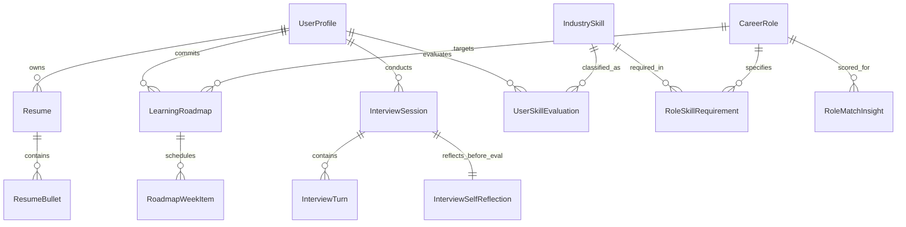

# Data Schema & Models (Schema.md)
## CAREERSTUDENT AI — Adaptive Career Co-Pilot

---

### 1. Prinsip Desain Skema Data (Architectural Principles)

Skema data dirancang untuk memenuhi kriteria teknis dari modul PRD serta pedoman skill arsitektur:
1. **Human-in-the-Loop & State Machine**: Setiap rekomendasi AI memiliki status eksplisit (`PENDING_REVIEW`, `APPROVED`, `MANUALLY_EDITED`, `REJECTED`).
2. **PWA Offline-First & Sync Resiliency (`progressive-web-apps-pwas`)**: Struktur data mendukung *optimistic UI*, penandaan timestamp versi lokal (`localVersion`, `isSynced`), dan antrean sinkronisasi IndexedDB saat perangkat kembali online.
3. **Optimasi Serialisasi & Server Performance (`vercel-react-best-practices`)**: Skema dinormalisasi secara efisien guna meminimalkan ukuran payload JSON ke React Server Components (RSC) dan mencegah *over-fetching*.
4. **Anti-Slop Data Integrity (`stop-making-ui-slop`)**: Tidak ada metrik palsu (*no fake numbers*). Skor ATS, kecocokan STAR, dan matriks kompetensi selalu didukung bukti teks (*evidence*) dan rincian analitis riil.

---

### 2. Diagram Relasi Entitas (Entity-Relationship Diagram)



---

### 3. Definisi Skema Database Relasional (Prisma ORM / SQLite / PostgreSQL)

```prisma
datasource db {
  provider = "postgresql" // PostgreSQL Production Database (Neon Cloud / Local)
  url      = env("DATABASE_URL")
}

generator client {
  provider = "prisma-client-js"
}

// ----------------------------------------------------
// 1. Profil Pengguna & Privasi Data
// ----------------------------------------------------
model UserProfile {
  id                  String              @id @default(cuid())
  name                String
  email               String?             @unique
  educationLevel      EducationLevel      @default(FINAL_YEAR_STUDENT)
  targetRoleId        String?
  targetRoleTitle     String?
  dataConsentAccepted Boolean             @default(true)
  createdAt           DateTime            @default(now())
  updatedAt           DateTime            @updatedAt

  resumes             Resume[]
  skillEvaluations    UserSkillEvaluation[]
  roadmaps            LearningRoadmap[]
  interviewSessions   InterviewSession[]
  matchInsights       RoleMatchInsight[]

  @@index([targetRoleId])
}

enum EducationLevel {
  FINAL_YEAR_STUDENT
  FRESH_GRADUATE
}

// ----------------------------------------------------
// 2. Modul 01: CV / Resume & Reflective ATS Optimizer
// ----------------------------------------------------
model Resume {
  id              String         @id @default(cuid())
  userId          String
  user            UserProfile    @relation(fields: [userId], references: [id], onDelete: Cascade)
  rawTextContent  String
  atsScore        Int            @default(0) // 0 - 100
  parsedSections  String         // JSON stringified: education, experience, skills
  createdAt       DateTime       @default(now())
  updatedAt       DateTime       @updatedAt

  bullets         ResumeBullet[]

  @@index([userId])
}

model ResumeBullet {
  id                  String         @id @default(cuid())
  resumeId            String
  resume              Resume         @relation(fields: [resumeId], references: [id], onDelete: Cascade)
  sectionType         SectionType
  originalText        String
  critique            String?        // Observasi objektif kelemahan diksi
  socraticPrompt      String?        // Pertanyaan pemantik AI Sokratik
  userReflectionText  String?        // Jawaban refleksi otentik pengguna
  suggestedFormula    String?        // Draf formula: Action Verb + Context + Metric
  finalText           String?        // Hasil akhir yang disetujui
  approvalStatus      ApprovalStatus @default(PENDING_REVIEW)
  orderIndex          Int            @default(0)
  createdAt           DateTime       @default(now())
  updatedAt           DateTime       @updatedAt

  @@index([resumeId, sectionType])
}

enum SectionType {
  EXPERIENCE
  PROJECT
  ORGANIZATION
  EDUCATION
  SKILL
}

enum ApprovalStatus {
  PENDING_REVIEW
  APPROVED
  MANUALLY_EDITED
  REJECTED
}

// ----------------------------------------------------
// 3. Modul 02: Taksonomi Keterampilan & Learning Roadmap
// ----------------------------------------------------
model IndustrySkill {
  id            String                @id @default(cuid())
  name          String                @unique
  category      SkillCategory
  description   String?
  roleReqs      RoleSkillRequirement[]
  userEvals     UserSkillEvaluation[]

  @@index([category])
}

enum SkillCategory {
  TECHNICAL
  TOOL
  SOFT_SKILL
  DOMAIN_KNOWLEDGE
}

model CareerRole {
  id                String                 @id @default(cuid())
  title             String                 @unique
  industry          String
  description       String
  skillRequirements RoleSkillRequirement[]
  roadmaps          LearningRoadmap[]
  matchInsights     RoleMatchInsight[]

  @@index([industry])
}

model RoleSkillRequirement {
  id            String         @id @default(cuid())
  roleId        String
  skillId       String
  role          CareerRole     @relation(fields: [roleId], references: [id], onDelete: Cascade)
  skill         IndustrySkill  @relation(fields: [skillId], references: [id], onDelete: Cascade)
  requiredLevel SkillLevel     @default(INTERMEDIATE)
  isCritical    Boolean        @default(false)

  @@unique([roleId, skillId])
}

enum SkillLevel {
  BEGINNER
  INTERMEDIATE
  ADVANCED
}

model UserSkillEvaluation {
  id            String         @id @default(cuid())
  userId        String
  skillId       String
  user          UserProfile    @relation(fields: [userId], references: [id], onDelete: Cascade)
  skill         IndustrySkill  @relation(fields: [skillId], references: [id], onDelete: Cascade)
  matchStatus   MatchStatus
  evidenceText  String?        // Penggalan resume/portofolio pendukung
  createdAt     DateTime       @default(now())

  @@unique([userId, skillId])
  @@index([userId, matchStatus])
}

enum MatchStatus {
  STRONG_MATCH
  PARTIAL_MATCH
  CRITICAL_GAP
}

model LearningRoadmap {
  id              String            @id @default(cuid())
  userId          String
  targetRoleId    String
  user            UserProfile       @relation(fields: [userId], references: [id], onDelete: Cascade)
  targetRole      CareerRole        @relation(fields: [targetRoleId], references: [id], onDelete: Cascade)
  title           String
  totalWeeks      Int               @default(4)
  isCurrentActive Boolean           @default(true)
  createdAt       DateTime          @default(now())
  updatedAt       DateTime          @updatedAt

  weekItems       RoadmapWeekItem[]

  @@index([userId, isCurrentActive])
}

model RoadmapWeekItem {
  id              String         @id @default(cuid())
  roadmapId       String
  roadmap         LearningRoadmap @relation(fields: [roadmapId], references: [id], onDelete: Cascade)
  weekNumber      Int
  objective       String
  tasksJson       String         // JSON array: string daftar tugas praktis
  resourcesJson   String         // JSON array: kurasi referensi belajar
  isCompleted     Boolean        @default(false)
  approvalStatus  ApprovalStatus @default(PENDING_REVIEW)
  createdAt       DateTime       @default(now())
  updatedAt       DateTime       @updatedAt

  @@index([roadmapId, weekNumber])
}

// ----------------------------------------------------
// 4. Modul 03: Cognitive Mock Interview Simulator
// ----------------------------------------------------
model InterviewSession {
  id                  String                    @id @default(cuid())
  userId              String
  user                UserProfile               @relation(fields: [userId], references: [id], onDelete: Cascade)
  targetRole          String
  interviewType       InterviewType             @default(BEHAVIORAL_STAR)
  sessionState        InterviewState            @default(IN_PROGRESS)
  
  // Evaluasi STAR (0 - 100)
  scoreSituation      Int?
  scoreTask           Int?
  scoreAction         Int?
  scoreResult         Int?
  cognitiveReflectionScore Int?
  
  overallSynthesis    String?                   // Analisis akhir AI
  createdAt           DateTime                  @default(now())
  updatedAt           DateTime                  @updatedAt

  turns               InterviewTurn[]
  selfReflection      InterviewSelfReflection?

  @@index([userId, sessionState])
}

enum InterviewType {
  BEHAVIORAL_STAR
  SITUATIONAL_ROLE
}

enum InterviewState {
  IN_PROGRESS
  AWAITING_SELF_REFLECTION
  COMPLETED
}

model InterviewTurn {
  id                  String            @id @default(cuid())
  sessionId           String
  session             InterviewSession  @relation(fields: [sessionId], references: [id], onDelete: Cascade)
  turnIndex           Int
  isFollowUpProbe     Boolean           @default(false)
  aiQuestion          String
  userAnswer          String            // Teks respon pengguna
  starAssessmentNote  String?           // Analisis komponen STAR mikro
  createdAt           DateTime          @default(now())

  @@index([sessionId, turnIndex])
}

model InterviewSelfReflection {
  id                  String            @id @default(cuid())
  sessionId           String            @unique
  session             InterviewSession  @relation(fields: [sessionId], references: [id], onDelete: Cascade)
  strongestPoint      String            // Jawaban pengguna: poin paling kuat
  weakestPoint        String            // Jawaban pengguna: area yang dirasa mengambang
  personalLearning    String            // Refleksi metakognitif pengguna
  submittedAt         DateTime          @default(now())
}

// ----------------------------------------------------
// 5. Modul 04: Career Discovery & Explainable AI
// ----------------------------------------------------
model RoleMatchInsight {
  id                  String       @id @default(cuid())
  userId              String
  roleId              String
  user                UserProfile  @relation(fields: [userId], references: [id], onDelete: Cascade)
  role                CareerRole   @relation(fields: [roleId], references: [id], onDelete: Cascade)
  fitScore            Int          // 0 - 100
  whyRelevant         String       // Explainable AI: Alasan kecocokan
  challengesToFace    String       // Explainable AI: Tantangan / mitigasi
  createdAt           DateTime     @default(now())

  @@unique([userId, roleId])
  @@index([userId, fitScore])
}
```

---

### 4. Skema Client-Side Offline Cache & PWA Sync (IndexedDB / Dexie.js)

Mengacu pada panduan skill `progressive-web-apps-pwas`, aplikasi mempertahankan fungsionalitas *offline draft* melalui IndexedDB lokal di browser pengguna:

```typescript
// types/offline-store.ts
export interface OfflineDraft {
  localId: string;
  entityType: 'RESUME_BULLET' | 'INTERVIEW_ANSWER' | 'ROADMAP_ITEM';
  serverId?: string;
  payload: Record<string, any>;
  approvalStatus: 'PENDING_REVIEW' | 'APPROVED' | 'MANUALLY_EDITED' | 'REJECTED';
  localUpdatedAt: number;
  syncStatus: 'SYNCED' | 'DIRTY_LOCAL' | 'CONFLICT';
}

export interface OfflineSyncQueue {
  id: string;
  endpoint: string;
  method: 'POST' | 'PUT' | 'PATCH' | 'DELETE';
  body: Record<string, any>;
  timestamp: number;
  retryCount: number;
}
```

#### Kebijakan Resolusi Konflik (Conflict Resolution):
1. **Penyuntingan Resume**: Perubahan `MANUALLY_EDITED` oleh pengguna di perangkat lokal selalu menang (*User Authority Principle*) atas pembaruan server.
2. **Mock Interview**: Transkrip jawaban lokal di-*flush* ke server saat jaringan pulih sebelum evaluasi Sokratik berikutnya dilanjutkan.

---

### 5. Type Contract TypeScript (Optimasi Serialisasi RSC)

Mengacu pada aturan `server-serialization` di `vercel-react-best-practices`, payload API dipangkas hanya mengirimkan data penting:

```typescript
// types/api-contracts.ts

// Respon Minimalis untuk Halaman Review Resume
export interface SocraticReviewPayload {
  bulletId: string;
  sectionType: string;
  originalText: string;
  critique: string;
  socraticPrompt: string;
  approvalStatus: 'PENDING_REVIEW' | 'APPROVED' | 'MANUALLY_EDITED' | 'REJECTED';
}

// Respon Minimalis untuk Matriks Gap
export interface SkillGapSummary {
  matchPercentage: number;
  strongMatches: string[];
  partialMatches: string[];
  criticalGaps: string[];
}

// Respon Simulasi Wawancara
export interface InterviewTurnResponse {
  turnIndex: number;
  aiQuestion: string;
  isFollowUpProbe: boolean;
  isSessionComplete: boolean;
}
```
