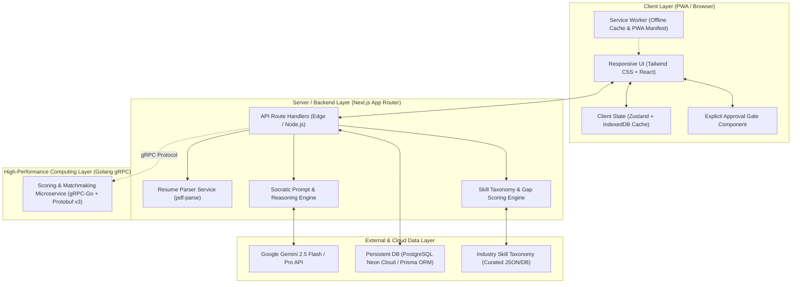

# Technical Specification (TechSpec)
## CAREERSTUDENT AI — Adaptive Career Co-Pilot

---

### 1. Arsitektur Sistem & Gambaran Umum (System Architecture)

CAREERSTUDENT AI dibangun dengan arsitektur **Modern Full-Stack PWA (Progressive Web App)** yang mengintegrasikan kemampuan pemrosesan AI generatif secara *low-latency* dengan prinsip kognitif *Human-in-the-Loop*.



---

### 2. Pilihan Stack Teknologi (Tech Stack Rationale)

| Komponen | Teknologi | Justifikasi Teknis |
| :--- | :--- | :--- |
| **Framework Web & API** | **Next.js 14+ (App Router, TypeScript)** | Menyediakan SSR/SSG untuk performa tinggi, Route Handlers terintegrasi untuk API tanpa perlu server terpisah, dan dukungan PWA yang matang. |
| **PWA Engine** | **@ducanh2912/next-pwa** (atau Serwist) | Mengelola *Service Worker*, web app manifest, cache aset statis, serta mendukung kapabilitas *installable app* di mobile dan desktop. |
| **Styling & UI Components** | **Tailwind CSS + Radix UI / Shadcn UI + Lucide Icons** | Memberikan desain modern, responsif *mobile-first*, aksesibel, cepat di-*bundle*, dan mudah dikustomisasi sesuai panduan desain. |
| **State Management** | **Zustand + TanStack Query** | Manajemen *state* client-side yang ringan untuk melacak alur *Approval Gate*, status sesi wawancara, dan sinkronisasi data cache. |
| **Database & ORM** | **SQLite / LibSQL via Prisma ORM** (atau Drizzle) | *Zero-config*, cepat, ideal untuk prototipe kompetisi Gen-Think dengan kemudahan migrasi ke PostgreSQL/Supabase saat fase produksi. |
| **LLM Provider & SDK** | **Google Gemini API (@google/genai)** | Model Gemini 2.5 Flash / 1.5 Pro menawarkan jendela konteks besar untuk menganalisis resume lengkap, penalaran logis tinggi untuk *Socratic Prompting*, dan latensi rendah. |
| **Resume Extraction** | **pdf-parse / unpdf** | Parsing teks dari dokumen CV PDF secara lokal di server tanpa dependensi biner pihak ketiga yang berat. |

---

### 3. Arsitektur Cognitive Bridge & Prompt Engineering

Untuk menjamin ketaatan pada filosofi *Human-in-the-Loop*, interaksi AI diatur oleh 3 pilar arsitektur kognitif:

#### 3.1 Socratic Prompting Framework
AI tidak pernah diizinkan menulis ulang output secara sepihak (*anti-hallucination / anti-ghostwriting*). Sistem menerapkan *system instruction* khusus:
* **Peran:** *Career Dialectical Mentor*.
* **Pola Evaluasi:** 
  1. Identifikasi klaim/poin yang belum spesifik atau belum terukur.
  2. Berikan observasi objektif.
  3. Lontarkan pertanyaan pemantik (*probing question*) berbasis konteks pengguna.
  4. Tunggu respon pengguna sebelum menawarkan formulasi kalimat alternatif.

#### 3.2 Explicit Approval State Machine
Setiap entitas rekomendasi memiliki siklus status (*lifecycle state*):
```
[DRAFT / REKOMENDASI AI] 
       │
       ▼
[USER REVIEW & REFLECTION] 
       │
       ├──► [DISETUJUI] ─────────► (Disimpan ke Dokumen/Profil Aktif)
       ├──► [DIEDIT MANUAL] ─────► (Disimpan versi kustom pengguna)
       └──► [DITOLAK / RE-PROBE] ─► (AI mengajukan sudut pandang lain)
```

#### 3.3 STAR Evaluation Engine (Mock Interview)
Pada modul wawancara, respon pengguna diproses dengan analisis struktural:
* **Situation:** Apakah latar belakang masalah dijelaskan secara ringkas?
* **Task:** Apakah tanggung jawab personal pengguna didefinisikan secara jelas?
* **Action:** Apakah aksi konkret yang diambil menunjukkan kompetensi dan penalaran kritis?
* **Result:** Apakah dampak atau metrik hasil disebutkan?
* **Cognitive Reflection Score:** Menilai sejauh mana pengguna mampu merefleksikan pelajaran dari keberhasilan/kegagalan masa lalunya.

---

### 4. Spesifikasi Kontrak API (API Specifications)

#### 4.1 Modul CV & Resume Analyzer
* **`POST /api/resume/parse`**
  * *Request:* `multipart/form-data` (file: `resume.pdf` atau `text/plain`).
  * *Response:*
    ```json
    {
      "success": true,
      "parsedData": {
        "summary": "Mahasiswa Sistem Informasi...",
        "sections": { "education": [...], "experience": [...], "skills": [...] }
      }
    }
    ```
* **`POST /api/resume/analyze-reflective`**
  * *Request:* `{ resumeData: object, targetRole: string }`
  * *Response:*
    ```json
    {
      "atsScore": 72,
      "insights": [
        {
          "sectionId": "exp_1",
          "originalText": "Membantu membuat website himpunan",
          "critique": "Kurang menunjukkan peran spesifik, teknologi yang dipakai, dan dampak terukur.",
          "socraticPrompt": "Teknologi apa yang kamu gunakan, dan berapa banyak mahasiswa yang aktif mengakses website tersebut?",
          "suggestedSTARStructure": "Kembangkan dengan formula: [Action Verb] + [Context/Tech] + [Measurable Outcome]"
        }
      ]
    }
    ```

#### 4.2 Modul Skill-Gap & Roadmap
* **`POST /api/skillgap/evaluate`**
  * *Request:* `{ userSkills: string[], targetRoleId: string }`
  * *Response:*
    ```json
    {
      "matchPercentage": 65,
      "categorizedSkills": {
        "strongMatch": ["JavaScript", "HTML/CSS"],
        "partialMatch": ["React basics"],
        "criticalGap": ["TypeScript", "State Management", "CI/CD"]
      },
      "weeklyRoadmap": [
        {
          "week": 1,
          "objective": "TypeScript Fundamentals & Strict Typing",
          "actionableTasks": ["Pelajari generics dan interface", "Refactor proyek lama ke TS"],
          "approvalStatus": "PENDING_CONFIRMATION"
        }
      ]
    }
    ```

#### 4.3 Modul Cognitive Mock Interview
* **`POST /api/interview/start`**
  * *Request:* `{ targetRole: string, interviewType: "BEHAVIORAL" | "TECHNICAL" }`
  * *Response:* `{ sessionId: string, firstQuestion: string }`
* **`POST /api/interview/submit-answer`**
  * *Request:* `{ sessionId: string, questionIndex: number, userAudioOrText: string }`
  * *Response:*
    ```json
    {
      "followUpQuestion": "Menarik, saat kamu menghadapi konflik jadwal di tim tersebut, alternatif apa yang sempat kamu pertimbangkan sebelum mengambil keputusan itu?",
      "isSessionComplete": false
    }
    ```
* **`POST /api/interview/evaluate-session`**
  * *Request:* `{ sessionId: string, userSelfReflection: string }`
  * *Response:*
    ```json
    {
      "starBreakdown": { "situation": 85, "task": 80, "action": 75, "result": 70 },
      "cognitiveFeedback": "Kemampuan penalaranmu kuat pada problem-solving, namun kuantifikasi dampak (Result) masih dapat diperdalam...",
      "growthActionItems": [...]
    }
    ```

#### 4.4 Modul Career Opportunity & Discovery
* **`GET /api/career/opportunities?skills=...&interests=...`**
  * *Response:*
    ```json
    {
      "recommendations": [
        {
          "roleTitle": "Junior Frontend Engineer",
          "fitScore": 82,
          "explainabilityReason": "Kombinasi portofolio React dan minat visual UI kamu sangat sejalan dengan peran ini.",
          "challengeToAnticipate": "Industri menuntut kebiasaan testing (Jest/Playwright) yang belum tercantum di profilmu."
        }
      ]
    }
    ```

---

### 5. Strategi PWA & Ketahanan Sistem (PWA & Offline Resilience)

1. **Manifest File (`manifest.json`):**
   * *Name:* CareerStudent AI
   * *Short Name:* CareerAI
   * *Display:* `standalone`
   * *Theme Color:* Diselaraskan pada tahap `Design.md`.
2. **Caching Strategy (Service Worker):**
   * *App Shell & Static Assets:* Cache-First strategy untuk loading instan.
   * *API Calls (AI Responses):* Network-First dengan fallback ke penyimpanan lokal IndexedDB jika perangkat kehilangan sinyal internet saat membaca ulang draf.
3. **Data Loss Prevention:**
   * Setiap ketikan jawaban wawancara atau refleksi resume otomatis di-*auto-save* ke *local state* browser setiap 2 detik.

---

### 6. Keamanan & Kepatuhan Privasi Data

1. **Prinsip Minimalisasi Data:**
   * Dokumen resume yang diunggah diproses di memori (*in-memory stream*) untuk ekstraksi teks, tanpa menyimpan file mentah PDF secara permanen jika tidak diizinkan.
2. **Sanitasi Prompt:**
   * Menghilangkan informasi sensitif (NIK, nomor telepon, alamat rumah lengkap) sebelum dikirim ke endpoint LLM untuk menjaga privasi personal pengguna.
3. **LLM Zero-Training Assumption:**
   * Menggunakan API Enterprise/Developer dengan kebijakan data yang menjamin data input pengguna tidak digunakan untuk melatih model publik.
